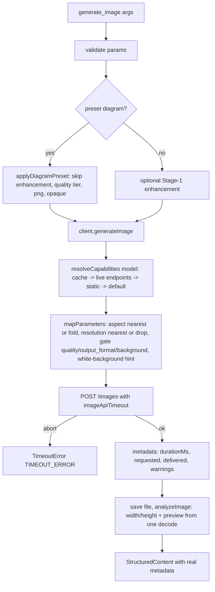

# Image Server GPT Model Fixes - Plan

**Target packages:** `mcp-image-openrouter/` (primary), `mcp-audio-openrouter/` (timeout classification and env loading only), repo root (`.env`, `.gitignore`, `README.md`).

## Goal Capsule

- **Objective:** A caller of `generate_image` with an OpenAI GPT image model gets a finished image instead of a 30 s failure, learns from the tool result exactly what size, aspect and format were delivered versus requested, and can pick the right model and settings for text-exact diagrams without reading source code.
- **Means:** per-call image timeout from env (KTD1), typed timeout error (KTD2), per-model capability lookup with nearest-aspect mapping and visible warnings (KTD3, KTD4), real result metadata (KTD6), `outputFormat` and `preset: "diagram"` tool parameters (KTD5, KTD7), shared root `.env` (KTD8), bundled model guide (KTD10).
- **Authority:** the USER DECISIONS in the Key Decisions section are binding; this plan's KTDs decide mechanism; code comments and docs follow the plan.
- **Stop conditions:** stop and report if the OpenRouter `GET /images/models/{id}/endpoints` record does not expose per-parameter enums (KTD3 fallback still ships, but say so); stop if `npm run check:all` cannot pass in a touched package without weakening a check.
- **Execution profile:** test-first per unit (vitest, `src/**/__tests__/`), files under 500 lines, no secrets printed or committed, tooling files (`CLAUDE.md`, `.claude/`, `.claude-flow/`, `.swarm/`) never committed.
- **Who finishes and ships:** the implementing session on branch `fix/image-gpt-models`; the user pushes if the shell push fails on credential-manager auth.

---

## Product Contract

### Summary

Fix `mcp-image-openrouter` so GPT image models (`openai/gpt-5-image`, `gpt-image-2`, `gpt-image-2.5-*`) work end to end: configurable image timeout, honest timeout errors, per-model parameter mapping with requested/delivered reporting, real metadata, PNG control, a diagram preset, a bundled model guide, and a shared monorepo `.env`.
The audio server receives the same timeout classification fix and the same env loader.

### Problem Frame

On 2026-10-16 the image server was driven over stdio with `OPENROUTER_IMAGE_MODEL=openai/gpt-5-image`, `aspectRatio: "16:9"`, `imageSize: "4K"`, `quality: "quality"` to produce a slide flowchart.
Every call failed at exactly 30 s because `apiTimeout` is hard-coded (`src/utils/config.ts` `DEFAULT_CONFIG`) and GPT image models need 60-120 s; the abort surfaced as `NETWORK_ERROR` with "check your internet connection".
Once the timeout was raised by hand, the delivered image was 1536x1024 (3:2): `MODEL_CAPABILITIES` in `src/api/openrouterImageClient.ts` lists only Gemini models, so for GPT the aspect and size were folded into the prompt and silently ignored by the provider.
The result metadata reports `processingTime: 0` and no pixel size, so the caller cannot judge slide resolution.
The API key was only found because the server happened to be started with `cwd` set to `mcp-audio-openrouter/`, which has the only `.env` in the repo.
Brief inaccuracies already corrected by analysis: the client uses the Images API (`POST {baseUrl}/images`), not chat completions; `quality: "quality"` is the server tier that selects `OPENROUTER_IMAGE_MODEL_HQ`, and the OpenRouter `quality` knob is never sent today.

### Requirements

**Timeouts and errors**
- R1. The image client's request timeout is read from `OPENROUTER_IMAGE_TIMEOUT_MS` (default 180000) and validated as a positive integer; the text client keeps its 30 s `apiTimeout`.
- R2. A `fetch` abort (`TimeoutError` / `AbortError`) is reported as a timeout error whose suggestion names `OPENROUTER_IMAGE_TIMEOUT_MS` and the elapsed limit, not as a network error.
- R3. The audio server classifies the same aborts as a timeout error instead of `NETWORK_ERROR`.

**Parameter mapping**
- R4. For the active model, `aspectRatio` is sent natively when supported, mapped to the nearest natively supported aspect when the model has an aspect list (`16:9`, `21:9`, `4:3`, `5:4` -> `3:2`; `9:16`, `3:4`, `4:5` -> `2:3`; `1:1` -> `1:1`), and folded into the prompt only when the model exposes no aspect parameter.
- R5. `imageSize` is sent natively when supported, mapped to the nearest listed resolution when the model has a list, and dropped (never folded into the prompt) when the model exposes no resolution parameter.
- R6. Every aspect or resolution mapping, drop or fold, every dropped `background`, and every dropped caller-supplied `outputFormat` (a preset default that cannot be sent is dropped silently) produces a warning in the tool result, and the result reports requested versus delivered `aspectRatio` and `imageSize`; each warning states what was requested, what was delivered and why, and ends with a fixed pointer to `get_model_guide` (the `quality` gate of R8 is silent).
- R7. Model capabilities come from a cached live lookup of `GET {baseUrl}/images/models/{id}/endpoints`, falling back to a static map, then to a conservative default; lookup failure never fails generation.
- R8. On the `quality` tier the request carries OpenRouter `quality: "high"` when the model's capabilities list `quality`; other tiers send no `quality`.

**Result metadata and output control**
- R9. The result metadata carries the real request duration in ms, the delivered width, height and format (`png` / `jpeg` / `webp`), and the warnings and requested/delivered pairs from R6.
- R10. The caller can request `outputFormat` (`png` / `jpeg` / `webp`); it is sent as `output_format` only when the model's accepted format list contains it, otherwise a warning says the model decides the format.
- R11. `preset: "diagram"` skips prompt enhancement for that call, defaults the tier to `quality`, requests OpenRouter `quality: "high"`, `background: "opaque"` and `output_format: "png"` where the model supports each, and the request shaping adds a white-background hint to the prompt when `background` was requested but is unsupported; an explicit caller `quality` wins over the preset default.

**Configuration and environment**
- R12. Both servers load `.env` relative to their own module location: the package `.env` first, then the repo-root `.env`, never overriding variables already set by the MCP client.
- R13. The repo-root `.gitignore` ignores `.env`, `.env.local` and `.env.*.local`; the existing audio `.env` moves to the repo root without its contents being printed or committed.
- R14. The image server sets Node's default autoselect-family attempt timeout to 500 ms at startup.

**Guidance**
- R15. A model guide (which OpenRouter image model for which task, parameters, cost, prompting tips) ships inside the image package as a content module, exposed as a `get_model_guide` tool and an MCP resource, with a short summary and a pointer to the tool in the `generate_image` tool description.
- R16. READMEs document GPT image model sizes, timing and cost; timeout and Windows `NODE_OPTIONS` troubleshooting; key location; the diagram preset; the `inputImagePath` fix-a-typo edit loop; and the model guide.

**Verification**
- R17. One opt-in live smoke test calls `openai/gpt-5-image` once at OpenRouter quality `medium` (about $0.06), asserts a PNG, the delivered 1536x1024 size in metadata, the requested-versus-delivered warning for `16:9`/`4K`, and `durationMs > 0`; the quality override is test-only and never a public tool parameter.

### Key Decisions

- **Shared root `.env`, package `.env` wins when present** (session-settled: user-directed — chosen over per-server `.env` files: one key location for the monorepo, while a package-local file still allows per-server overrides). Governs R12, R13.
- **Map unsupported aspect to nearest native, drop unsupported resolution, report requested versus delivered with warnings; default model unchanged** (session-settled: user-directed — chosen over silently folding into the prompt, erroring, or switching the default model to a GPT model: honest results without breaking existing Gemini users). Governs R4, R5, R6.
- **Send `quality: "high"` only on the `quality` tier and only when the model lists `quality`** (session-settled: user-directed — chosen over sending it on every tier: keeps `fast`/`balanced` cheap and avoids 400s on models that reject the field). Governs R8.
- **Build the diagram preset, document the fix-a-typo loop, run the live smoke test once at OpenRouter quality `medium` (approved spend about $0.06), and fix the audio timeout misclassification** (session-settled: user-directed — chosen over leaving the optional items out: the slide-figure workflow is the motivating use case). Governs R3, R11, R16, R17.
- **Ship the model guide inside the image server as a content file, exposed as resource and tool** (session-settled: user-directed — chosen over README-only: the assistant driving the tool needs the guide at call time; content arrives from the research scratchpad). Governs R15.
- **Feature branch `fix/image-gpt-models`; tooling files never committed** (session-settled: user-directed — chosen over committing on `main`). Governs the Definition of Done.
- **Env var name, default and validation; live capability lookup with static fallback; new `TimeoutError`; jimp for dimensions; optional `outputFormat`; `net.setDefaultAutoSelectFamilyAttemptTimeout(500)`** (session-settled: user-approved — proposed with trade-offs in the analysis; the user accepted them as defaults). Governs R1, R2, R7, R9, R10, R14.

### Success Criteria

- A `generate_image` call against `openai/gpt-5-image` with `aspectRatio: "16:9"`, `imageSize: "4K"` succeeds within the default timeout and its result JSON shows `requested.aspectRatio: "16:9"`, `delivered.aspectRatio: "3:2"`, a non-empty `warnings` array, `width`/`height` matching the file, `format: "png"` and `durationMs > 0`.
- A forced timeout surfaces `code: "TIMEOUT_ERROR"` with a suggestion that names `OPENROUTER_IMAGE_TIMEOUT_MS`, in both servers' error envelopes (the audio suggestion names its 120 s default).
- `npm run check:all` passes in both packages with the live test skipped, and the live test passes once when opted in.

### Scope Boundaries

- Not changing `OPENROUTER_IMAGE_MODEL` defaults or the quality-tier model selection (decision D2 in `mcp-image-openrouter/docs/SPEC.md` §2).
- Not adding a timeout env var to the audio server; its classification fix uses the existing 120 s `apiTimeout`.
- Not setting the autoselect-family timeout in the audio server.
- Not folding resolution hints into the prompt for any model (replaces the current folding; see KTD4).
- Not surfacing `n > 1`, `seed`, `output_compression`, streaming or provider routing fields.
- Considered and not built: retrying a timed-out generation automatically; a retry would double spend on a slow provider and the caller already sees the timeout with a fix. Evidence that would change this: repeated transient aborts well under the configured limit.
- Considered and not built: a persistent on-disk capability cache, and coalescing of concurrent first lookups for one model; the per-process cache costs at most one small public GET per model per server lifetime, and a stdio client rarely overlaps first calls. Evidence that would change this: rate limiting on the endpoints route.
- Considered and not built: a static table that recommends an alternative model inside a warning; the static map is the stale fallback and the model guide (R15) already owns model choice, so warnings point at `get_model_guide` instead.

#### Deferred to Follow-Up Work

- `OPENROUTER_AUDIO_TIMEOUT_MS` for the audio server, mirroring KTD1.
- `outputFormat: "svg"` for vector models (Recraft lists `svg` in `output_format`); needs `image/svg+xml` in `mimeUtils`, a save path without jimp decoding, and a preview fallback.
- Rename `GeminiAPIError` to a provider-neutral name (SPEC §12.2).
- Chat-completions surface for `openai/gpt-5-image` image+text models (`docs/OPENROUTER_API.md` Surface B/C).

---

## Planning Contract

### Key Technical Decisions

- KTD1. **Separate `imageApiTimeout` in `Config`, read from `OPENROUTER_IMAGE_TIMEOUT_MS`, default 180000.** `apiTimeout` (30000) stays for `openrouterTextClient.ts`. Accept only a trimmed raw value matching `^\d+$` with a positive numeric value; anything else (letters, decimals such as `12.5`, zero, negatives) returns a `ConfigError` following the existing `apiTimeout` validation shape in `validateConfig`. (session-settled: user-approved — chosen over reusing `apiTimeout` for both clients: a 180 s wait is wrong for a prompt-enhancement call.)
- KTD2. **New `TimeoutError` (`code: 'TIMEOUT_ERROR'`) in each package's `utils/errors.ts`, constructed from `(message, timeoutMs)` and carrying `timeoutMs` in context.** `handleThrownError` (image) and `classifyThrownError` (audio) check `name === 'TimeoutError' || name === 'AbortError'` before the network checks. `responseBuilder.convertErrorToStructured` and `errorHandler.convertErrorToStructured` in both packages add the class to their `instanceof` lists; `timeoutMs` joins `SAFE_CONTEXT_KEYS` so it reaches `details`. (session-settled: user-approved — chosen over a `NetworkError` subclass: a distinct code lets callers branch.)
- KTD3. **Capability resolution lives in `src/api/modelCapabilities.ts` (image).** Shape: `{ aspectRatios: string[] | null, resolutions: string[] | null, outputFormats: string[] | null, quality: boolean, background: boolean }` where `null` means the model exposes no such parameter; per-model parameter subsets differ (Recraft lists `svg`, GPT lists no `output_format`), so every field is read generically from the record. Resolution order per model id: in-memory `Map` cache -> live `GET {baseUrl}/images/models/{encodedId}/endpoints` (auth header, `apiTimeout` signal, defensive parse) -> `STATIC_CAPABILITIES` -> `DEFAULT_CAPABILITIES` (all `null`/`false`). A model may have several `endpoints[]` records with different enums (`google/gemini-3-pro-image`: AI Studio `1K,2K,4K`, Vertex `1K,2K`); the parser takes the UNION of each parameter's values across all endpoints, matching the `GET /images/models` list record, so a value any endpoint accepts stays requestable. Any fetch or parse failure logs a warning and falls through; the record that resolved is cached. Follows `mcp-audio-openrouter/src/api/modelCatalog.ts`. (session-settled: user-approved — chosen over a static map only: the GPT family changes monthly.)
- KTD4. **Pure mapping in `src/api/parameterMapping.ts`.** Nearest aspect = minimum `|ln(w/h requested) - ln(w/h candidate)|` over candidates matching `^\d+(\.\d+)?:\d+(\.\d+)?$` (non-ratio tokens such as `auto` are excluded from the computation), which yields the user's table for the GPT set `{1:1, 3:2, 2:3}` and sends extreme ratios (`1:8`, `8:1`) to `2:3`/`3:2`. Nearest resolution compares pixel class order `512 < 768 < 1K < 1.5K < 2K < 4K`. Resolution is never folded into the prompt because providers ignore size prose; aspect is still folded when no aspect parameter exists because composition is expressible in text (decision D4 in `mcp-image-openrouter/docs/SPEC.md` §2). Returns `{ request fields, promptSuffix, requested, delivered, warnings[] }`; every warning ends with the fixed `get_model_guide` pointer (R6). When `background` was requested but `caps.background` is false, the mapping appends the white-background hint to `promptSuffix` (R11), so the preset stays capability-free.
- KTD5. **`quality: 'high'` is attached in `buildRequest` only when `params.quality === 'quality'` and `caps.quality`.** `outputFormat` is attached as `output_format` only when `caps.outputFormats` contains it; `background` only when `caps.background` is true; otherwise a warning is appended (R10), except that an `outputFormat` that came only from the preset default is dropped silently (R6). `ImageApiParams` gains `outputFormat?`, `outputFormatExplicit?` (set by the server only when the caller supplied the value), `background?`, and a test-only `openrouterQuality?: 'low' | 'medium' | 'high'` that overrides the tier-derived `high` and is never exposed in the tool schema or `GenerateImageParams` (R17).
- KTD6. **Metadata is enriched in two places.** The client stamps `durationMs` (wall clock around `fetch` plus body decode) and the mapping results on `GeneratedImageResult.metadata`; `mcpServer.handleGenerateImage` obtains `width`/`height` from one jimp decode shared with the preview: `thumbnail.ts` exposes `analyzeImage(imageData, { withPreview })` returning `{ width, height, preview? }` (best effort, replaces `generateThumbnail`), so a 4K PNG is decoded once whether or not `IMAGE_INLINE_PREVIEW` is on. `StructuredContent.metadata` gains `durationMs`, `width?`, `height?`, `format`, `requested`, `delivered`, `warnings`; `processingTime` is kept and set to `durationMs` for existing readers.
- KTD7. **The diagram preset is resolved server-side by a pure `applyDiagramPreset` in `src/business/generationPresets.ts`** that returns the effective `skipEnhancement`, `quality`, `outputFormat` and `background`; it has no capability input. The client gates each field by capability and adds the white-background hint when needed (KTD4, KTD5).
- KTD8. **Per-package `src/utils/loadEnv.ts` is a side-effect module** that resolves `[<package>/.env, <repo-root>/.env]` from ITS OWN `import.meta.url` (`src/utils` and `dist/utils` sit at the same depth, so `../..` is the package and `../../..` the repo root) and loads them in that order without override at module evaluation. Entry points (`src/index.ts`, `src/server-main.ts`) and both live smoke tests use `import './utils/loadEnv.js'` (or the relative equivalent) as their first import instead of `dotenv/config`; because ESM hoists static imports, a function call could not reproduce that ordering. Pure `resolveEnvPaths(moduleUrl)` and `loadEnv(paths, processEnv)` are exported for tests. Each package keeps its own copy; the packages stay independent (root README). (session-settled: user-directed — see Key Decisions.)
- KTD9. **`net.setDefaultAutoSelectFamilyAttemptTimeout(500)` runs at the top of image `server-main.ts`** before any fetch; README troubleshooting still documents `NODE_OPTIONS=--network-family-autoselection-attempt-timeout=500` for clients that launch `dist/index.js` through other entry points.
- KTD10. **Model guide content is a TypeScript module `src/guide/modelGuide.ts`** exporting `MODEL_GUIDE_MARKDOWN` and `MODEL_GUIDE_SUMMARY`, because `tsc` ships only `.ts` output and `docs/` is excluded from the npm `files` allowlist. Exposed through a `get_model_guide` tool (reliable in every client) and a `guide://image-models` resource (`capabilities.resources`, `ListResources` and `ReadResource` handlers). To stay under 500 lines, `mcpServer.ts` moves tool and resource schema literals into `src/server/toolDefinitions.ts`.
- KTD11. **Live smoke test `src/api/__tests__/openrouterImage.live.test.ts`** mirrors the audio pattern: `it.skipIf(!enabled)` on `RUN_LIVE_SMOKE && OPENROUTER_API_KEY`, model from `LIVE_SMOKE_IMAGE_MODEL` (default `openai/gpt-5-image`), OpenRouter quality from `LIVE_SMOKE_IMAGE_QUALITY` (default `medium`, passed through the test-only `openrouterQuality` param of KTD5), output under `os.tmpdir()`, per-test timeout 240000 ms, `.env` via the `loadEnv` side-effect import so the root key is found.

### High-Level Technical Design

Request shaping per call (authoritative flow for KTD3-KTD7):

Capability record states (KTD3): `fresh` (first call for a model) -> `live` or `static` or `default` once resolved; the resolved record is cached for the process lifetime and the same record is reused by every later call for that model.

### Assumptions

Un-validated bets made without a synchronous user; correct them during implementation if evidence disagrees.

- The endpoints record for a model exposes per-parameter enums (the analysis read `aspect_ratio {1:1,3:2,2:3,auto}` and `quality {auto,low,medium,high}` for `openai/gpt-5-image`); the exact JSON path must be confirmed from one real response saved as a test fixture.
- The preset parameter is named `preset` with enum `['diagram']`; a `default` value is unnecessary because omission is the default.
- Both a tool and a resource are wanted for the guide ("and/or" in the decision); the tool is the one clients reliably surface.
- Resolution is never folded into the prompt, including for unknown models (replaces the existing `Render at high resolution` fold and its test).
- `STATIC_CAPABILITIES` seeds: the current Gemini rows (with `google/gemini-3-pro-image` resolutions `1K,2K,4K`, the union of its endpoints) plus `openai/gpt-5-image`, `openai/gpt-5-image-mini`, `openai/gpt-image-1`, `openai/gpt-image-2`, `openai/gpt-image-2.5-sunburst`, `openai/gpt-image-2.5-flare` from the research guide (aspect sets, no resolution, `quality` true, `background` true, `outputFormats` null).
- The audio timeout suggestion names the fixed 120 s default and advises a shorter prompt or retry, since no audio timeout env var exists yet.
- Width/height come from the server-side decode shared with the preview rather than from the client, keeping the client transport-only.
- Verified on the installed toolchain, so not assumptions: `dotenv@16.6.1` accepts `path: string[]` (first file wins) and a `processEnv` target; `@modelcontextprotocol/sdk@1.29.0` exports `ListResourcesRequestSchema` and `ReadResourceRequestSchema`; Node 24 exposes `net.setDefaultAutoSelectFamilyAttemptTimeout`.

---

## Implementation Units

| U-ID | Title | Key files | Depends on |
|---|---|---|---|
| U1 | Image timeout env var | `mcp-image-openrouter/src/utils/config.ts` | - |
| U2 | Image `TimeoutError` classification | `src/utils/errors.ts`, `src/api/openrouterImageClient.ts`, `src/api/imageClient.ts`, `src/business/responseBuilder.ts`, `src/server/errorHandler.ts` | U1 |
| U3 | Audio `TimeoutError` classification | `mcp-audio-openrouter/src/utils/errors.ts`, `src/api/errorClassification.ts`, `src/api/modelCatalog.ts`, `src/api/openrouterAudioClient.ts`, `src/api/speechEndpoint.ts`, `src/business/responseBuilder.ts`, `src/server/errorHandler.ts` | - |
| U4 | Capability lookup module | `mcp-image-openrouter/src/api/modelCapabilities.ts` | - |
| U5 | Parameter mapping and request shaping | `src/api/parameterMapping.ts`, `src/api/openrouterImageClient.ts`, `src/api/imageClient.ts` | U2, U4 |
| U6 | Result metadata | `src/utils/thumbnail.ts`, `src/business/responseBuilder.ts`, `src/types/mcp.ts`, `src/server/mcpServer.ts` | U5 |
| U7 | `outputFormat` and diagram preset | `src/business/generationPresets.ts`, `src/business/inputValidator.ts`, `src/types/mcp.ts`, `src/server/toolDefinitions.ts`, `src/server/mcpServer.ts` | U5, U6 |
| U8 | Model guide tool and resource | `src/guide/modelGuide.ts`, `src/server/toolDefinitions.ts`, `src/server/mcpServer.ts` | U7 |
| U9 | Env loading, root `.env`, autoselect family | both `src/utils/loadEnv.ts`, both `src/index.ts` and `src/server-main.ts`, root `.gitignore` | - |
| U10 | Live smoke test | `src/api/__tests__/openrouterImage.live.test.ts` | U5, U6, U9 |
| U11 | README and API docs | both `README.md`, root `README.md`, `mcp-image-openrouter/docs/OPENROUTER_API.md` | U1-U10 |

### U1. Image timeout env var

- **Goal:** `Config.imageApiTimeout` exists, defaults to 180000, is read from `OPENROUTER_IMAGE_TIMEOUT_MS`, and is validated.
- **Requirements:** R1 (KTD1).
- **Dependencies:** none.
- **Files:** `mcp-image-openrouter/src/utils/config.ts`, `src/utils/__tests__/config.test.ts`; every test `makeConfig`/`baseConfig` helper that builds a `Config` literal gains the new field (`openrouterImageClient.test.ts`, `mcpServer.generate.test.ts` if it builds one).
- **Approach:** add the field to `Config` and `DEFAULT_CONFIG`; in `getConfig` parse the env value; in `validateConfig` reject non-integer or non-positive values with a `ConfigError` whose suggestion names the variable and the default. Add the variable to `OPENROUTER_ENV_VARS` in the test.
- **Execution note:** write the config tests first; they define the error text.
- **Test scenarios:**
  - Unset variable yields `imageApiTimeout === 180000` and `apiTimeout === 30000`.
  - `OPENROUTER_IMAGE_TIMEOUT_MS=90000` yields 90000 and leaves `apiTimeout` at 30000.
  - `OPENROUTER_IMAGE_TIMEOUT_MS=abc`, `0`, `-5`, `12.5` each return a `ConfigError` mentioning `OPENROUTER_IMAGE_TIMEOUT_MS`.
  - `validateConfig` with `imageApiTimeout: 0` fails; with `1` passes.
- **Verification:** config tests pass; `npm run build` compiles every `Config` literal.

### U2. Image `TimeoutError` classification

- **Goal:** an aborted image request is reported as `TIMEOUT_ERROR` with an actionable suggestion, and the client uses `imageApiTimeout`.
- **Requirements:** R1, R2 (KTD2).
- **Dependencies:** U1.
- **Files:** `src/utils/errors.ts`, `src/api/openrouterImageClient.ts`, `src/api/imageClient.ts`, `src/business/responseBuilder.ts`, `src/server/errorHandler.ts`; tests `src/utils/__tests__/errors.test.ts`, `src/api/__tests__/openrouterImageClient.test.ts`, `src/business/__tests__/responseBuilder.test.ts`, `src/server/__tests__/errorHandler.test.ts`.
- **Approach:**
  1. Add `TimeoutError extends BaseError` with `code 'TIMEOUT_ERROR'`, constructor `(message, timeoutMs)` storing `timeoutMs` in context, suggestion "Raise OPENROUTER_IMAGE_TIMEOUT_MS (currently N ms); GPT image models typically need 60-120 s".
  2. In `handleThrownError`, test `name` for `TimeoutError`/`AbortError` first and return the new error with `timeoutMs: this.config.imageApiTimeout`; the `fetch` signal becomes `AbortSignal.timeout(this.config.imageApiTimeout)`.
  3. Add the class to both `convertErrorToStructured` `instanceof` lists and `'timeoutMs'` to both `SAFE_CONTEXT_KEYS`; widen `ImageClient`'s error union in `imageClient.ts`.
- **Patterns to follow:** `ImageAPIError` constructor and `buildPublicDetails` in `responseBuilder.ts`.
- **Test scenarios:**
  - `fetch` rejects with an error named `TimeoutError`: result code `TIMEOUT_ERROR`, suggestion contains `OPENROUTER_IMAGE_TIMEOUT_MS` and `180000` (or the configured value).
  - `fetch` rejects with an error named `AbortError`: same classification.
  - `fetch` rejects with `connect ECONNRESET`: still `NETWORK_ERROR` (existing test unchanged).
  - `fetch` is called with a signal; the mocked `AbortSignal.timeout` receives `imageApiTimeout`, not `apiTimeout`.
  - `responseBuilder.buildErrorResponse(new TimeoutError(...))` emits `code: 'TIMEOUT_ERROR'` and `details.timeoutMs`.
  - `ErrorHandler.handleError` on a `TimeoutError` keeps the code (not `INTERNAL_ERROR`).
- **Verification:** all four test files pass; no `NETWORK_ERROR` path remains for aborts.

### U3. Audio `TimeoutError` classification

- **Goal:** the audio server reports aborts as `TIMEOUT_ERROR`.
- **Requirements:** R3 (KTD2).
- **Dependencies:** none.
- **Files:** `mcp-audio-openrouter/src/utils/errors.ts`, `src/api/errorClassification.ts`, its callers `src/api/modelCatalog.ts`, `src/api/openrouterAudioClient.ts`, `src/api/speechEndpoint.ts`, `src/business/responseBuilder.ts`, `src/server/errorHandler.ts`; tests `src/utils/__tests__/errors.test.ts`, `src/api/__tests__/speechEndpoint.test.ts` (the existing "maps a TimeoutError from fetch to NETWORK_ERROR" case flips to `TIMEOUT_ERROR`), `src/api/__tests__/modelCatalog.test.ts`, `src/business/__tests__/responseBuilder.test.ts`, `src/server/__tests__/errorHandler.test.ts`.
- **Approach:** same class and wiring as U2; `classifyThrownError` gains a `timeoutMs` argument (the three callers pass `config.apiTimeout`) so the suggestion can say "exceeded the 120000 ms audio timeout; retry or shorten the prompt/music length". Widen the return union of `classifyThrownError` and the clients that propagate it.
- **Test scenarios:**
  - `requestSpeech` with a `TimeoutError` rejection returns `TIMEOUT_ERROR` whose suggestion includes `120000`.
  - `AbortError` classifies the same; `ECONNREFUSED` remains `NETWORK_ERROR`.
  - `modelCatalog` catalog fetch abort returns `TIMEOUT_ERROR` (through `classifyThrownError`).
  - Audio `responseBuilder` and `errorHandler` preserve the code and `details.timeoutMs`.
- **Verification:** `npm run check:all` in `mcp-audio-openrouter/` passes.

### U4. Capability lookup module

- **Goal:** `resolveCapabilities(model)` returns a capability record from live data, static map or default, cached per process.
- **Requirements:** R7 (KTD3).
- **Dependencies:** none.
- **Files:** `mcp-image-openrouter/src/api/modelCapabilities.ts`, `src/api/__tests__/modelCapabilities.test.ts`, fixtures `src/api/__tests__/fixtures/gpt-5-image.endpoints.json` and `gemini-3-pro-image.endpoints.json` (captured from real unauthenticated GETs during implementation; the records are public).
- **Approach:**
  1. Define `ModelCapabilities`, `STATIC_CAPABILITIES` (Gemini rows from the current `MODEL_CAPABILITIES` converted to lists per `docs/OPENROUTER_API.md` §3.3, plus the GPT rows named in Assumptions) and `DEFAULT_CAPABILITIES`.
  2. Factory `createCapabilityResolver(config)` holding a `Map<string, ModelCapabilities>` cache (no request coalescing; see Scope Boundaries).
  3. Parser reads the per-parameter enums (`endpoints[].supported_parameters.<param>.values`, confirm against the fixture) from every endpoint and unions them per parameter; a missing or unparseable record returns `null` so the caller falls through.
- **Patterns to follow:** `mcp-audio-openrouter/src/api/modelCatalog.ts` (`loadCatalog`, `parseCatalog`, logger usage).
- **Test scenarios:**
  - Fixture response yields `aspectRatios` containing `3:2` and `2:3`, `resolutions === null`, `quality === true`, `outputFormats === null`.
  - A fixture for a model listing `output_format` (for example a Recraft vector record) yields `outputFormats` containing `svg`.
  - The two-endpoint `gemini-3-pro-image` fixture yields `resolutions` containing `4K` (union, not intersection).
  - Second call for the same model does not call `fetch` again.
  - HTTP 404 falls back to the static record for `openai/gpt-5-image` and logs a warning.
  - Network rejection for an unknown model falls back to `DEFAULT_CAPABILITIES`.
  - Malformed JSON falls back without throwing.
  - The GET URL encodes the slash in the model id correctly for `{baseUrl}/images/models/<id>/endpoints` (assert the exact URL the live API accepts, verified during fixture capture).
- **Verification:** module tests pass; `knip` reports no unused exports.

### U5. Parameter mapping and request shaping

- **Goal:** `buildRequest` sends only parameters the model accepts, maps or folds the rest, and records requested/delivered/warnings and `durationMs`.
- **Requirements:** R4, R5, R6, R8, R10, R11 hint (KTD4, KTD5, KTD6 client half).
- **Dependencies:** U2, U4.
- **Files:** `src/api/parameterMapping.ts`, `src/api/__tests__/parameterMapping.test.ts`, `src/api/openrouterImageClient.ts`, `src/api/imageClient.ts` (adds `outputFormat?` and `background?` to `ImageApiParams`), `src/api/__tests__/openrouterImageClient.test.ts`.
- **Approach:**
  1. `mapParameters(params, caps)` returns `{ aspect_ratio?, resolution?, quality?, output_format?, background?, promptSuffix, requested, delivered, warnings }` per KTD4 and KTD5; every warning ends with the fixed `get_model_guide` pointer; a requested-but-unsupported `background` appends the white-background hint to `promptSuffix`.
  2. The client replaces `MODEL_CAPABILITIES` with the resolver from U4 (constructed in `createOpenRouterImageClient`), calls `mapParameters`, and spreads the result into `ImagesApiRequest` (extended with `quality`, `output_format`, `background`).
  3. Time the request; stamp `durationMs`, `requested`, `delivered`, `warnings` on `metadata` (extend `ImageGenerationMetadata`).
  4. Update the existing folding test ("folds imageSize into the prompt") to the new drop-with-warning behavior.
- **Test scenarios (mapping):**
  - GPT caps, `16:9` -> `aspect_ratio '3:2'`, warning names `16:9` and `3:2`; `21:9`, `4:3`, `5:4` -> `3:2`; `9:16`, `3:4`, `4:5` -> `2:3`; `1:1` -> `1:1` with no warning.
  - GPT caps, `imageSize '4K'` -> no `resolution`, warning says the model has no resolution parameter and ends with the `get_model_guide` pointer.
  - GPT caps (`background` true), `background 'opaque'` -> sent natively, no hint; default caps, `background 'opaque'` -> field absent, `promptSuffix` contains the white-background hint, warning emitted.
  - `google/gemini-3.1-flash-lite-image` caps (`1K` only), `4K` -> `resolution '1K'` with warning; `google/gemini-3-pro-image` caps (`1K,2K,4K`), `4K` -> native, no warning.
  - Caps `['1:1','3:2','2:3','auto']`, `16:9` -> `aspect_ratio '3:2'` (`auto` ignored by the nearest computation).
  - `outputFormat 'png'` from the preset default (not explicit) against `outputFormats null` -> field absent and no warning; the same value supplied explicitly -> warning.
  - `openrouterQuality 'medium'` with `quality: 'quality'` and `caps.quality` -> `quality 'medium'` sent.
  - Default caps (unknown model), `16:9` -> no `aspect_ratio`, prompt suffix contains `16:9`, warning says folded.
  - `quality: 'quality'` + `caps.quality` -> `quality 'high'`; `quality: 'fast'` -> field absent; `caps.quality false` -> field absent and no warning.
  - `outputFormat 'png'` with `caps.outputFormats null` -> absent plus warning; with `['png','jpeg','webp']` -> `output_format 'png'`; `jpeg` against `['png']` -> absent plus warning.
  - `delivered` mirrors native values and is `null` for dropped/folded fields.
- **Test scenarios (client):**
  - Existing native Gemini test still passes `aspect_ratio` and `resolution` unchanged.
  - Metadata `durationMs` is a positive number when `fetch` resolves after a fake-timer delay.
  - Metadata `warnings` is an empty array when everything is native.
- **Verification:** both test files pass; `openrouterImageClient.ts` stays under 500 lines.

### U6. Result metadata

- **Goal:** the tool result carries real duration, delivered pixel size, format, requested/delivered pairs and warnings.
- **Requirements:** R9 (KTD6).
- **Dependencies:** U5.
- **Files:** `src/utils/thumbnail.ts`, `src/utils/__tests__/thumbnail.test.ts`, `src/business/responseBuilder.ts`, `src/business/__tests__/responseBuilder.test.ts`, `src/types/mcp.ts`, `src/server/mcpServer.ts`, `src/server/__tests__/mcpServer.generate.test.ts`.
- **Approach:**
  1. `analyzeImage(buffer, { withPreview })` in `thumbnail.ts` returns `Result<{ width, height, preview? }, Error>` from one jimp decode and replaces `generateThumbnail` (update its tests; `knip` must not see a dead export).
  2. `mcpServer.handleGenerateImage` calls it once after save with `withPreview: config.inlinePreview` (best effort, logs a warning on failure) and stamps `width`/`height` on `metadata`.
  3. `buildSuccessResponse` emits `durationMs`, `processingTime` (same value), `width`, `height`, `format` (from `mimeType` via `mimeUtils`), `requested`, `delivered`, `warnings`; `StructuredContent.metadata` type updated.
- **Test scenarios:**
  - A real 600x400 PNG (jimp-generated, as in `mcpServer.generate.test.ts`) yields `width 600`, `height 400`, and a preview only when `withPreview` is true.
  - A non-image buffer returns an error Result, and the server response omits `width`/`height` and the preview while still succeeding.
  - `responseBuilder` with `mimeType image/webp` reports `format 'webp'`; `image/png` reports `'png'`.
  - `responseBuilder` passes through `warnings`, `requested`, `delivered`, and `durationMs === processingTime`.
  - Existing `responseBuilder` equality assertion on `metadata` is updated to the new shape.
  - Full `generate_image` flow (mocked client) returns JSON whose `metadata.width` is 600 and `metadata.durationMs` equals the mocked value.
- **Verification:** tests pass; the JSON text block still parses.

### U7. `outputFormat` and diagram preset

- **Goal:** callers can request `outputFormat` and `preset: "diagram"`.
- **Requirements:** R10, R11 (KTD5, KTD7).
- **Dependencies:** U5, U6.
- **Files:** `src/business/generationPresets.ts`, `src/business/__tests__/generationPresets.test.ts`, `src/business/inputValidator.ts`, `src/business/__tests__/inputValidator.test.ts`, `src/types/mcp.ts`, `src/server/toolDefinitions.ts` (new, holds the `generate_image` schema moved out of `mcpServer.ts`), `src/server/mcpServer.ts`, `src/server/__tests__/mcpServer.test.ts`, `src/server/__tests__/mcpServer.generate.test.ts`.
- **Approach:**
  1. Add `outputFormat?: 'png' | 'jpeg' | 'webp'` and `preset?: 'diagram'` to `GenerateImageParams`, validate both in `validateGenerateImageParams`.
  2. `applyDiagramPreset(params)` returns `{ skipEnhancement: true, quality: params.quality ?? 'quality', outputFormat: params.outputFormat ?? 'png', background: 'opaque' }`; `handleGenerateImage` honors `skipEnhancement` per call and passes `outputFormat`/`background` to the client, which applies the capability gates and hint from U5.
  3. Tool schema documents both parameters and says JPEG/WebP add compression artefacts and that `diagram` is for text-exact figures.
- **Test scenarios:**
  - `preset: 'diagram'` with no `quality` yields `quality 'quality'`; with `quality: 'fast'` keeps `fast`.
  - Preset yields `outputFormat 'png'` unless the caller set `jpeg`.
  - Server flow with `SKIP_PROMPT_ENHANCEMENT` unset and `preset: 'diagram'`: `mockGenerateText` is not called and the image client receives `background 'opaque'`, `outputFormat 'png'`.
  - Server flow with the preset: the mocked `generateImage` receives `background 'opaque'` and `outputFormat 'png'` (the capability gate and hint are covered by U5's mapping tests).
  - `outputFormat: 'gif'` and `preset: 'poster'` each return `INPUT_VALIDATION_ERROR`.
  - `getToolsList` advertises `outputFormat` enum `['png','jpeg','webp']` and `preset` enum `['diagram']`.
- **Verification:** tests pass; `mcpServer.ts` under 500 lines after the schema extraction.

### U8. Model guide tool and resource

- **Goal:** the assistant can fetch the model guide at call time.
- **Requirements:** R15 (KTD10).
- **Dependencies:** U7.
- **Files:** `src/guide/modelGuide.ts`, `src/guide/__tests__/modelGuide.test.ts`, `src/server/toolDefinitions.ts`, `src/server/mcpServer.ts`, `src/server/__tests__/mcpServer.test.ts`.
- **Approach:**
  1. Fill `MODEL_GUIDE_MARKDOWN` by copying the content of the session scratchpad file `C:\Users\server-itx\AppData\Local\Temp\claude\D--jeffrymahbuubi-Self-Projects-mcp-related-openrouter-mcp\4ea59cc0-9428-40c2-b1a6-f86efb747bbd\scratchpad\image-model-guide.md` into the committed module (the scratchpad is ephemeral; the module becomes the only durable copy) — sections 1, the key-model parameter/cost table, per-model notes and prompting tips, with its "confirmed vs inferred" caveats kept as one short paragraph); `MODEL_GUIDE_SUMMARY` is two sentences naming the top picks for text-exact diagrams, photoreal and vector. Keep the module under 500 lines; escape backticks or build from a line array.
  2. Register `get_model_guide` (no required args, returns the markdown as a text block) and the `guide://image-models` resource (`mimeType text/markdown`); enable `capabilities.resources`.
  3. Prefix the `generate_image` description with `MODEL_GUIDE_SUMMARY` and a pointer to `get_model_guide` and `preset: "diagram"`.
- **Test scenarios:**
  - `getToolsList` returns two tools; `generate_image` description contains `get_model_guide`.
  - `callTool('get_model_guide')` returns a text block containing `openai/gpt-image-2.5-sunburst` and the diagram prompting tips heading.
  - `ListResources` lists `guide://image-models`; `ReadResource` on it returns markdown identical to `MODEL_GUIDE_MARKDOWN`; an unknown URI returns an error response.
  - `MODEL_GUIDE_MARKDOWN` contains the as-of date `2026-10-16`.
- **Verification:** tests pass; `knip` clean; the guide module under 500 lines.

### U9. Env loading, root `.env`, autoselect family

- **Goal:** both servers find the key in a shared root `.env`, package `.env` wins, and the image server avoids the Windows happy-eyeballs stall.
- **Requirements:** R12, R13, R14 (KTD8, KTD9).
- **Dependencies:** none.
- **Files:** `mcp-image-openrouter/src/utils/loadEnv.ts`, `src/utils/__tests__/loadEnv.test.ts`, `src/index.ts`, `src/server-main.ts`; the same three source files plus test in `mcp-audio-openrouter/`, and `mcp-audio-openrouter/src/api/__tests__/openrouterSpeech.live.test.ts` (swap `dotenv/config` for the side-effect import so it keeps finding the key after the move); root `.gitignore`; move `mcp-audio-openrouter/.env` to `./.env` (shell move, never `cat` or echo it); both packages' `knip.json` unchanged (entry already `src/server-main.ts`).
- **Approach:**
  1. `resolveEnvPaths(moduleUrl)` returns `[packageEnv, rootEnv]`; `loadEnv(paths, processEnv = process.env)` calls dotenv with `path: paths` (first file wins, no override); the module's top level runs `loadEnv(resolveEnvPaths(import.meta.url))` so importing it is enough (KTD8).
  2. Entry points replace `import 'dotenv/config'` with `import './utils/loadEnv.js'` as the first import.
  3. Image `server-main.ts` calls `net.setDefaultAutoSelectFamilyAttemptTimeout(500)` right after env loading.
  4. Root `.gitignore` gains the three `.env` patterns.
- **Execution note:** this unit is mostly wiring; prove it with the unit test plus one manual start of each server from an unrelated `cwd` confirming the key is found (do not print the key; log only `hasKey: true`).
- **Test scenarios:**
  - `resolveEnvPaths` from a `src/utils/` URL returns `<pkg>/.env` then `<repo>/.env`; from a `dist/utils/` URL it returns the same two paths.
  - `resolveEnvPaths(import.meta.url)` evaluated inside `loadEnv.ts` itself (exported for the test) yields the package's own `.env` first, proving the entry-point depth bug cannot recur.
  - With temp files `pkg/.env` (`X=pkg`) and `root/.env` (`X=root`, `Y=rootonly`), a fresh env object ends with `X=pkg`, `Y=rootonly`.
  - A pre-set `X=client` in the env object is not overridden by either file.
  - A missing package `.env` does not throw and the root file still loads.
  - `git check-ignore .env` at the repo root succeeds (shell verification, not a vitest case).
- **Verification:** both packages' tests pass; `git status` shows no `.env` anywhere.

### U10. Live smoke test

- **Goal:** one real `openai/gpt-5-image` call proves PNG delivery and the reported size, opt-in only.
- **Requirements:** R17 (KTD11).
- **Dependencies:** U5, U6, U9.
- **Files:** `mcp-image-openrouter/src/api/__tests__/openrouterImage.live.test.ts`.
- **Approach:** build a `Config` with `imageModel === imageModelHq === MODEL`, `imageApiTimeout 180000`, `imageOutputDir os.tmpdir()`; call `generateImage({ prompt: short three-box flowchart with two exact labels, aspectRatio '16:9', imageSize '4K', quality 'quality', openrouterQuality: process.env.LIVE_SMOKE_IMAGE_QUALITY ?? 'medium' })`; write the file to a `mkdtemp` directory; log a JSON line with path, size, duration, warnings.
- **Execution note:** run it exactly once after U5/U6 pass offline at quality `medium`; the user approved about $0.06 of spend (a `high` run would cost about $0.25 and is not approved).
- **Test scenarios:**
  - Result succeeds; `metadata.mimeType === 'image/png'` and the buffer starts with the PNG signature bytes.
  - `metadata.delivered.aspectRatio === '3:2'`, `metadata.requested.aspectRatio === '16:9'`, `metadata.requested.imageSize === '4K'`, `metadata.delivered.imageSize === null`, `warnings` has entries mentioning `16:9` and `4K`.
  - The request body sent carried `quality: 'medium'` (assert via the logged request or a fetch spy that still performs the real call).
  - `analyzeImage` on the returned buffer (the live test calls the client directly, so it decodes dimensions itself) gives `width 1536`, `height 1024`; `durationMs > 0`.
  - With `RUN_LIVE_SMOKE` unset the test is skipped and `npm test` makes no network call.
- **Verification:** the live run passes once with the logged JSON kept in the implementation notes; default `npm test` stays offline.

### U11. README and API docs

- **Goal:** users can configure, troubleshoot and choose models without reading source.
- **Requirements:** R16; documents R1-R15.
- **Dependencies:** U1-U10.
- **Files:** `mcp-image-openrouter/README.md` (Configuration table, new "GPT image models" section, "Diagram preset and fixing text" section, "Model guide" section, "Troubleshooting" section, "Development" with the live smoke command), `mcp-audio-openrouter/README.md` (key location, `TIMEOUT_ERROR`), root `README.md` (shared `.env` location and precedence), `mcp-image-openrouter/docs/OPENROUTER_API.md` §3.3 (GPT rows: aspects `1:1 3:2 2:3 auto`, no `resolution`/`output_format`, `quality`, `background`, pricing from the analysis; the `gemini-3-pro-image` row states the union `1K, 2K, 4K` and the per-endpoint split as a note).
- **Approach:** GPT section states sizes (1024x1024, 1536x1024, 1024x1536 for `gpt-5-image`; 16:9 -> 1536x864 on `gpt-image-2`), timing (60-120 s) and cost (`$0.00004` per output-image token, roughly $0.04-0.21 per image); troubleshooting covers `TIMEOUT_ERROR` -> `OPENROUTER_IMAGE_TIMEOUT_MS`, the Windows `NODE_OPTIONS` line, and the collapsed-preview tip already present; the fix-a-typo loop shows a `generate_image` call with `inputImagePath` of the previous output, `preset: "diagram"`, and a prompt of the form "change only the label X to Y; keep everything else identical". Note JPEG/WebP compression artefacts next to `outputFormat`.
- **Test expectation:** none -- documentation; verify every env var, parameter and error code named in the READMEs exists in code (`rg` the identifiers).
- **Verification:** README tables list `OPENROUTER_IMAGE_TIMEOUT_MS`, `outputFormat`, `preset`, `get_model_guide`; no API key or `.env` content appears in any doc.

---

## Verification Contract

| Gate | Command (per package) | Applies to |
|---|---|---|
| Unit and integration tests | `npm test` in `mcp-image-openrouter/` and `mcp-audio-openrouter/` | U1-U9 |
| Full quality gate | `npm run check:all` in each touched package (biome, lint, format, dpdm, knip, tsc, vitest) | every unit |
| Live smoke (once, opt-in, quality `medium`) | `RUN_LIVE_SMOKE=1 npx vitest run src/api/__tests__/openrouterImage.live.test.ts` in `mcp-image-openrouter/`, key from root `.env`, `LIVE_SMOKE_IMAGE_QUALITY` left at its `medium` default | U10 |
| Secret hygiene | `git status` shows no `.env`; `git check-ignore .env` succeeds; `git diff --cached` contains no `sk-or-` | U9, every commit |
| Size rule | every touched source file under 500 lines (`wc -l`) | U5, U7, U8 |

Named failure paths to prove: abort -> `TIMEOUT_ERROR` (both servers); capability GET failure -> generation still succeeds via static/default record; image decode failure -> response without `width`/`height`/preview but `isError: false`.

---

## Definition of Done

- All units implemented on branch `fix/image-gpt-models`, each test-first, with `npm run check:all` green in both packages.
- The live smoke test has passed once and its JSON log line is recorded in the PR or commit body (no key, no `.env` content).
- `processingTime` is no longer `0`; `delivered`, `requested`, `warnings`, `width`, `height`, `format`, `durationMs` appear in a real tool result.
- READMEs updated per U11; `docs/OPENROUTER_API.md` §3.3 lists the GPT rows.
- Root `.gitignore` lists `.env`, `.env.local` and `.env.*.local` (never a bare `.env*`, which would hide `.env.example` files); `mcp-audio-openrouter/.env` no longer exists and `./.env` is untracked and ignored.
- No `CLAUDE.md`, `.claude/`, `.claude-flow/`, `.swarm/` or `.env` file is staged in any commit.
- Dead code from abandoned approaches removed; `knip` and `dpdm` clean.
- Commits made; push attempted, with the credential-manager failure handed to the user if it recurs.

## Open Questions

None blocking. Execution-time discoveries are listed under Assumptions and are resolved by the implementer with evidence (endpoints JSON path, dotenv array support).
