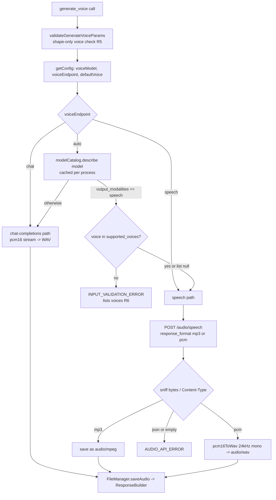

# ElevenLabs Speech via generate_voice - Plan

**Target package:** `mcp-audio-openrouter/` (all paths below are relative to that package unless prefixed with `../`).

## Goal Capsule

- **Objective:** An operator who sets `OPENROUTER_VOICE_MODEL` to an ElevenLabs model (or any other OpenRouter speech-only TTS model) gets playable speech files back from `generate_voice`, with the voice they asked for, while an operator who never changes config keeps the exact GPT Audio behavior they have today.
- **Means:** Route speech-only models to OpenRouter's `POST /audio/speech` endpoint inside the existing `generate_voice` tool, and open the `voice` parameter to provider-specific voice IDs (KTD1, KTD3).
- **Authority:** Product Contract requirements (R-IDs) win on behavior; Key Technical Decisions (KTDs) win on mechanism; the three user decisions listed under Key Decisions are binding and are not re-opened.
- **Execution profile:** Test-first. Every feature-bearing unit lands its vitest coverage (mocked `fetch`) before the implementation it proves. Exactly one opt-in live smoke test exists; default `npm test` must spend no OpenRouter credits.
- **Stop conditions:** Stop and report if (a) `POST /audio/speech` turns out to reject every ElevenLabs model with the body shape documented below, or (b) the catalog lookup `GET /models?output_modalities=speech` starts requiring auth or stops reporting `output_modalities` / `supported_voices`. Either invalidates KTD1/KTD2.
- **Finishes and ships:** The implementer commits on `feat/audio-elevenlabs-speech` and pushes; no release/publish step is part of this plan.

---

## Product Contract

### Summary

Extend `generate_voice` so that when the configured voice model is a speech-only TTS model (`architecture.output_modalities == ["speech"]`), the server calls OpenRouter's `/audio/speech` endpoint and saves the returned bytes; otherwise it keeps today's `/chat/completions` streaming path. The `voice` parameter becomes a free string validated for shape, not against a closed OpenAI list, and the server checks it against the model's `supported_voices` when the catalog provides one. Docs, the bundled skill, and the API contract notes are updated to describe both paths.

### Problem Frame

Today `generate_voice` is hard-wired to `openai/gpt-audio`: it always POSTs to `/chat/completions` with `modalities:["text","audio"]`, and `voice` is a closed enum of six OpenAI voices (`src/types/mcp.ts`, `src/business/inputValidator.ts`, `src/utils/config.ts`). OpenRouter now exposes ElevenLabs (`eleven-v3`, `eleven-v4`, `eleven-multilingual-v2`, `eleven-flash-v2.5`, and more) and roughly 30 other TTS models, but all of them are `text->speech` models served only by the separate `/audio/speech` endpoint, which `docs/SPEC.md` and `docs/OPENROUTER_API.md` currently declare out of scope. Setting `OPENROUTER_VOICE_MODEL=elevenlabs/eleven-v3` today produces an upstream error, and even if it reached the right endpoint the validator would reject every ElevenLabs voice name.

### Key Decisions

- **Extend `generate_voice`; no new tool.** Callers keep one speech tool; the endpoint is an implementation detail selected from the configured model. Governs R1, R2. `(session-settled: user-directed — chosen over a separate generate_speech tool: one tool, model-driven routing)`
- **TDD with mocked-fetch vitest units plus exactly one opt-in live smoke test against a real ElevenLabs model.** Governs R9, R10. `(session-settled: user-directed — chosen over multiple live tests or none: one credit-spending check, skipped by default)`
- **Work is committed on `feat/audio-elevenlabs-speech` and pushed.** Governs Definition of Done. `(session-settled: user-directed)`

### Requirements

**Routing and generation**

- R1. When the resolved voice model is speech-only, `generate_voice` sends `POST {baseUrl}/audio/speech` with `model`, `input` (the prompt), `voice`, and `response_format`, and saves the raw response bytes as the audio file.
- R2. When the resolved voice model is not speech-only, `generate_voice` behaves exactly as today (chat-completions streaming, `pcm16` wire format, WAV wrapping, transcript accumulation).
- R3. On the speech path, the tool's `format` parameter is honored: `mp3` requests `response_format: "mp3"` and saves the `audio/mpeg` bytes; `wav` requests `response_format: "pcm"` and wraps the 16-bit PCM in a WAV container (see KTD4 for the sample-rate assumption and OQ2).
- R4. The saved file's mime type on the speech path is determined by sniffing the returned bytes first (`src/utils/audioFormatSniffer.ts`) and by the response `Content-Type` second, never by trusting the request alone.

**Voice parameter**

- R5. `voice` accepts any provider voice identifier: a non-empty trimmed string of at most 128 characters containing no control characters. The six GPT Audio names remain valid inputs.
- R6. When the catalog reports a non-empty `supported_voices` list for the resolved model and the resolved voice (explicit or default) is not in it, the tool returns an `INPUT_VALIDATION_ERROR` whose message names the model and lists the supported voices, before any credits are spent.
- R7. `OPENROUTER_VOICE_DEFAULT` keeps its default `alloy` and accepts any string satisfying R5, so existing `.env` files keep working unchanged.

**Errors and metadata**

- R8. Speech-endpoint failures surface as `AUDIO_API_ERROR` with `statusCode`, the sanitized upstream JSON error message, and a status-specific suggestion (400 voice/parameter, 401 key, 402 credits, 404 model, 429 rate limit, 5xx/524/529 provider), mirroring the existing chat-path mapping.
- R9. Default `npm test` and `npm run check:all` run fully offline with mocked `fetch`; the single live smoke test is skipped unless an explicit opt-in environment variable is set and `OPENROUTER_API_KEY` is present.
- R10. The live smoke test calls one real ElevenLabs model once, asserts a non-empty playable file of the sniffed format, and writes only to a temporary directory.

**Documentation**

- R11. `docs/SPEC.md`, `docs/OPENROUTER_API.md`, `README.md`, `.env.example`, `skills/audio-generation/SKILL.md`, and `docs/PROGRESS.md` describe the two-path behavior, the open `voice` parameter, the new environment variable(s), and how to run the live smoke test.

### Scope Boundaries

- In scope: ElevenLabs first, but the routing is generic: any model the catalog marks `output_modalities: ["speech"]` takes the speech path. No ElevenLabs-specific code branches.
- Considered and not built: a per-call `model` parameter on `generate_voice`. SPEC D1 established that callers pick outcomes, not vendor slugs; mixing GPT Audio and ElevenLabs in one server instance is the only thing it would buy, and it can be added later without breaking the schema. See OQ4. Evidence that would change the call: a user workflow that needs both models in one session.
- Considered and not built: `instructions`, `speed`, multi-speaker `input` arrays, `input_references` (voice cloning). ElevenLabs ignores `instructions` (per OpenRouter docs); the others are provider-specific features outside the "spoken dialogue from a prompt" contract. Delivery direction stays inside the prompt text, as the skill already teaches.
- Considered and not built: an offline fallback list of known speech-only slugs when the catalog lookup fails. If `openrouter.ai` is unreachable, the generation call fails too; the explicit `OPENROUTER_VOICE_ENDPOINT` override (KTD2) is the escape hatch.
- Considered and not built: surfacing cost/usage. SPEC D5 still applies; `X-Generation-Id` is captured in metadata only because it is free and useful for support tickets.

### Deferred to Follow-Up Work

- A `list_voices` helper tool or `get_voice_models` resource that exposes the catalog to the agent (today the agent must read the model page or the error message from R6).
- Honoring `format: "mp3"` on the GPT Audio path (unchanged: still always WAV, SPEC D8).

### Acceptance Examples

- AE1. **Covers R1, R3, R4.** Given `OPENROUTER_VOICE_MODEL=elevenlabs/eleven-v3`, `voice: "george"`, `format: "mp3"`; when `generate_voice` runs; then one `POST .../audio/speech` with body `{model:"elevenlabs/eleven-v3", input:<prompt>, voice:"george", response_format:"mp3"}` is sent, no `/chat/completions` call is made, and the saved file is `audio/mpeg` with a `.mp3` extension.
- AE2. **Covers R2.** Given the default `OPENROUTER_VOICE_MODEL=openai/gpt-audio`, `voice: "alloy"`; when `generate_voice` runs; then the request is byte-for-byte what today's tests assert (chat completions, `pcm16`, `stream:true`) and the file is WAV.
- AE3. **Covers R6, R7.** Given `OPENROUTER_VOICE_MODEL=elevenlabs/eleven-v3` and no `OPENROUTER_VOICE_DEFAULT` (so the default `alloy` applies); when `generate_voice` runs without `voice`; then the response is `INPUT_VALIDATION_ERROR` naming `alloy`, the model, and the 21 ElevenLabs voices, and no `/audio/speech` request is sent.
- AE4. **Covers R5.** Given `voice: "en-US-Harper:MAI-Voice-2.1"` (Azure-style id with a colon); when validation runs; then it passes shape validation.
- AE5. **Covers R8.** Given the speech endpoint answers `402 {"error":{"code":402,"message":"Insufficient credits"}}`; when `generate_voice` runs; then the tool returns `AUDIO_API_ERROR` with `statusCode: 402` and a suggestion mentioning adding credits.
- AE6. **Covers R9.** Given `RUN_LIVE_SMOKE` is unset; when `npm test` runs; then the live smoke test is reported as skipped and `fetch` is never called against the network.

### Sources

- OpenRouter TTS guide: https://openrouter.ai/docs/guides/overview/multimodal/tts — request parameters (`model`, `input`, `voice`, `instructions`, `response_format` = `mp3 | pcm`, default `pcm`; `speed`; `provider.options`), raw-bytes response, `Content-Type` `audio/mpeg` / `audio/pcm`, `X-Generation-Id` header, model discovery via `GET /api/v1/models?output_modalities=speech`, voices listed per model page and in `supported_voices`.
- OpenRouter API reference, Create speech: https://openrouter.ai/docs/api/api-reference/tts/create-speech — `SpeechRequest` schema; only `model` and `input` required; `response_format` enum is `mp3`, `pcm` (`wav` is mentioned in the summary line but is not in the enum); PCM output is 16-bit little-endian; error codes 400/401/402/403/404/413/429/500/502/503/524/529.
- Per-model contract pages: https://openrouter.ai/elevenlabs/eleven-v3/llms.txt and https://openrouter.ai/elevenlabs/eleven-multilingual-v2/llms.txt — `voice` is one of `george, sarah, adam, alice, bella, bill, brian, callum, charlie, chris, daniel, eric, harry, jessica, laura, liam, lily, matilda, river, roger, will`; `response_format` defaults to `pcm`; success is raw bytes; failures are `{"error":{"code","message"}}`.
- OpenRouter TTS tutorial (2026-09-11): https://openrouter.ai/blog/tutorials/text-to-speech — "change the matching model and voice together when you switch providers"; voices are per provider.
- Live catalog check (2026-10-16, no auth): `GET https://openrouter.ai/api/v1/models?output_modalities=speech` returned 35 models, all `architecture.modality: "text->speech"`, `output_modalities: ["speech"]`, with a top-level `supported_voices` array (null for Fish Audio and Seed Audio, which take no fixed voice). ElevenLabs entries: `eleven-v4`, `eleven-v4-turbo`, `eleven-v3`, `eleven-v3-conversational`, `eleven-flash-v2.5`, `eleven-turbo-v2`, `eleven-multilingual-v2`, `eleven-turbo-v2.5`, `eleven-flash-v2`, each `pricing.prompt: "0.00004"` (per input character), `supported_parameters: []`. `GET https://openrouter.ai/api/v1/models/elevenlabs/eleven-v3/endpoints` also works without auth and carries `architecture.output_modalities`.
- Models API filter semantics: https://openrouter.ai/docs/models — `output_modalities` accepts `speech`.
- Repo evidence: `src/api/openrouterAudioClient.ts` (`generateVoice`, `streamAudioCompletion`, `buildHttpError`, `getAPIErrorSuggestion`), `src/utils/pcmToWav.ts` (`pcm16ToWav`, 24 kHz mono default), `src/utils/audioFormatSniffer.ts`, `src/utils/config.ts` (`validateConfig` enforces `VOICE_VALUES`), `src/business/inputValidator.ts`, `src/server/mcpServer.ts` (tool schema `enum: [...VOICE_VALUES]`), `vitest.config.mjs` (`include: src/**/*.{test,spec}.ts`), `package.json` (`files` excludes `__tests__`; `check:all` chain), `docs/SPEC.md` D1, D2, D8, D9 and the non-goals list, `docs/OPENROUTER_API.md` §1.

---

## Planning Contract

### Key Technical Decisions

- KTD1. **Route by catalog-derived capability, not by model-name prefix.** A model is speech-only when `architecture.output_modalities` equals `["speech"]`. The client fetches `GET {baseUrl}/models?output_modalities=speech` once per process (unauthenticated, verified live 2026-10-16; the payload carries both `output_modalities` and `supported_voices` per model, which the per-model `/models/{slug}/endpoints` route lacks) and caches the result as a map keyed by model id. Alternatives: (a) a static prefix list (`elevenlabs/`, `heygen/`, ...): zero network but goes stale as OpenRouter adds providers, and the catalog already has 35 entries across 15 vendors; (b) per-model `/endpoints` lookups: smaller payload but no voice list, so R6 would need a second call. Chosen for correctness over time; cost is one GET (roughly 35 entries) on the first `generate_voice` call. Governs R1, R2, R6. See OQ1 for the product-level confirmation.
- KTD2. **Explicit override `OPENROUTER_VOICE_ENDPOINT=auto|chat|speech` (default `auto`).** `auto` applies KTD1; `chat` and `speech` force a path and skip the catalog lookup entirely (voice-list check in R6 is then skipped too, since no catalog data exists). This is the escape hatch for offline/proxy setups and for models the catalog mislabels. Config validation rejects any other value with a `CONFIG_ERROR`.
- KTD3. **`Voice` becomes `string`; the GPT Audio six stay as a documented constant, not an enum.** `VOICE_VALUES` is renamed to `GPT_AUDIO_VOICES` and used only in the tool description and docs. Validation (R5) is shape-only; membership (R6) is data-driven. Backward compatible: every previously valid value is still valid. Governs R5, R7.
- KTD4. **Speech-path format mapping: `mp3 -> response_format "mp3"`; `wav -> response_format "pcm"` wrapped by `pcm16ToWav` at 24 kHz mono.** OpenRouter documents PCM as 16-bit little-endian; the sample rate is not documented generally (only the Azure section says 24 kHz mono, matching OpenAI's convention this project already assumes in `pcmToWav.ts`). The WAV header is therefore an assumption for ElevenLabs until the smoke test confirms pitch/duration by ear or by inspecting the byte length against the spoken text. Mitigation in U3: the sample rate is a named constant on the speech path (not shared with the GPT Audio constant) so a correction is one line. See OQ2 for whether the default output for speech-only models should instead be `mp3` to avoid the assumption entirely.
- KTD5. **Binary response handling: read the body with `response.arrayBuffer()`, sniff first, `Content-Type` second.** `audio/mpeg` bytes carry ID3/MPEG sync so the sniffer identifies them; `audio/pcm` is headerless and sniffs `unknown`, at which point `Content-Type: audio/pcm` plus the requested `pcm` format selects the WAV-wrapping branch. A 200 with `Content-Type: application/json` or a zero-length body is an `AUDIO_API_ERROR` at stage `audio_extraction`. Extends SPEC D9's "never trust the request" rule to the second endpoint.
- KTD6. **Error mapping reuses `buildHttpError` and extends `getAPIErrorSuggestion`.** Add explicit 402 (credits) and voice-related 400 (`voice` mentioned in the upstream message -> suggest checking the model's supported voices) branches. No new error class; `AudioAPIError` already carries `statusCode` and sanitized `upstreamMessage`. Governs R8.
- KTD7. **Live smoke test is a normal vitest file guarded by `it.skipIf(!process.env.RUN_LIVE_SMOKE || !process.env.OPENROUTER_API_KEY)`.** No second vitest config, no new dependency: the file sits under `src/api/__tests__/`, is excluded from the npm tarball by the existing `files` rules, reports as skipped in default runs, and runs when both variables are set. The model under test is `elevenlabs/eleven-flash-v2.5` (same per-character price tier as `eleven-v3` in the catalog, fastest, lowest latency risk against the 10 s vitest timeout, which the test overrides to 60 s). See OQ3.
- KTD8. **Split the client to stay under 500 lines.** `openrouterAudioClient.ts` is 360 lines; the speech path and catalog lookup go into two new modules (`src/api/modelCatalog.ts`, `src/api/speechEndpoint.ts`), and `generateVoice` becomes a router that delegates to one of two private paths. `knip` requires every export to be used; `dpdm` forbids cycles, so the new modules import from `utils/` only, never from `openrouterAudioClient.ts`.

### High-Level Technical Design



Request shapes (directional, not implementation specification):

```text
speech path  POST {baseUrl}/audio/speech
             { model, input: prompt, voice, response_format: "mp3" | "pcm" }
             200 -> raw bytes, Content-Type audio/mpeg | audio/pcm, X-Generation-Id
             4xx/5xx -> {"error":{"code","message"}}

chat path    unchanged (docs/OPENROUTER_API.md §2-§3)
```

### Assumptions

- `GET {baseUrl}/models?output_modalities=speech` remains unauthenticated and keeps `architecture.output_modalities` and `supported_voices` per model (verified 2026-10-16).
- ElevenLabs PCM via OpenRouter is 16-bit LE mono at 24 kHz (KTD4). The live smoke test is the first check of this.
- A custom `OPENROUTER_BASE_URL` points at an OpenRouter-compatible host that also serves `/models/...` and `/audio/speech`; if not, the operator sets `OPENROUTER_VOICE_ENDPOINT` explicitly.
- `.env.example` could not be read by the planner (permission-denied in this environment); the implementer must read it before editing it.

### Open Questions

All five questions were resolved by the user before implementation; the resolutions are binding.

- OQ1. **Speech-only detection strategy.** **Resolved:** catalog lookup (`GET /models?output_modalities=speech`, cached once per process) plus the `OPENROUTER_VOICE_ENDPOINT=auto|chat|speech` override (KTD1 + KTD2).
- OQ2. **Default output for speech-only models when `format` is omitted.** **Resolved:** keep the global `wav` default; request `pcm` and wrap it with `pcm16ToWav` at 24 kHz mono. The live smoke test verifies the sample rate (KTD4).
- OQ3. **Which ElevenLabs model the live smoke test uses.** **Resolved:** `elevenlabs/eleven-v3` (not flash). This supersedes the `eleven-flash-v2.5` default named in KTD7 and U6.
- OQ4. **Per-call `model` override on `generate_voice`.** **Resolved:** no. Model selection stays config-only (`OPENROUTER_VOICE_MODEL`).
- OQ5. **Behavior when the default voice is not supported by the configured model (R6).** **Resolved:** fail fast with `INPUT_VALIDATION_ERROR` listing the supported voices, before any paid request. No silent substitution.

### Risks and Dependencies

- Risk: OpenRouter changes `/audio/speech` (e.g., adds `wav` to `response_format`). Mitigation: the format mapping is isolated in `speechEndpoint.ts`; `docs/OPENROUTER_API.md` §6 records the verified contract and date.
- Risk: catalog lookup latency on first call. Mitigation: cached for the process lifetime; `apiTimeout` applies; override via KTD2.
- Risk: WAV header sample-rate mismatch for ElevenLabs PCM (KTD4). Mitigation: smoke test plus OQ2.
- Dependency: a funded `OPENROUTER_API_KEY` for the one live smoke run before merge.

---

## Implementation Units

### U1. Open the voice type and config to provider voices

- **Goal:** `voice` and `OPENROUTER_VOICE_DEFAULT` accept any well-formed provider voice id; add `OPENROUTER_VOICE_ENDPOINT`.
- **Requirements:** R5, R7, KTD2, KTD3.
- **Dependencies:** none.
- **Files:** `src/types/mcp.ts`, `src/business/inputValidator.ts`, `src/business/__tests__/inputValidator.test.ts`, `src/utils/config.ts`, `src/utils/__tests__/config.test.ts`, `src/api/audioClient.ts` (type only).
- **Approach:**
  1. Replace `type Voice = 'alloy' | ...` with `type Voice = string`; rename `VOICE_VALUES` to `GPT_AUDIO_VOICES` (kept for descriptions and docs).
  2. Add `validateVoiceId` in `inputValidator.ts` implementing R5 (trim, 1-128 chars, no control characters) and use it for `params.voice`.
  3. Add `voiceEndpoint: 'auto' | 'chat' | 'speech'` to `Config`, read from `OPENROUTER_VOICE_ENDPOINT`, default `auto`; validate the enum. Replace the `VOICE_VALUES.includes(defaultVoice)` check with the same shape rule as R5.
- **Execution note:** Write the failing validator and config tests first; the existing "should reject an invalid voice: robot" test must be rewritten to a shape failure (empty string, 129 chars, control char), since `robot` is now a valid shape.
- **Patterns to follow:** existing `validateGenerateMusicParams` structure; `ConfigError` messages naming the env var and valid options.
- **Test scenarios:**
  - `voice: "george"`, `"en-US-Harper:MAI-Voice-2.1"`, `"English_expressive_narrator"`, `"alloy"` all pass validation.
  - `voice: ""` and `voice: "   "` fail with `INPUT_VALIDATION_ERROR` mentioning non-empty.
  - A 129-character voice fails; a 128-character voice passes.
  - `voice: "geo\u0000rge"` fails (control character).
  - `OPENROUTER_VOICE_DEFAULT=george` loads; unset still yields `alloy`; empty string yields `CONFIG_ERROR`.
  - `OPENROUTER_VOICE_ENDPOINT` unset -> `auto`; `chat`/`speech` accepted; `foo` -> `CONFIG_ERROR` naming the three options.
- **Verification:** `npm run check:all` green; no remaining reference to `VOICE_VALUES`.

### U2. Model catalog lookup and speech-only detection

- **Goal:** A small module answers "is this model speech-only?" and "which voices does it support?" from OpenRouter's catalog, cached per process.
- **Requirements:** R1, R2, R6, KTD1, KTD2.
- **Dependencies:** U1 (for `voiceEndpoint` in `Config`).
- **Files:** `src/api/modelCatalog.ts` (new), `src/api/__tests__/modelCatalog.test.ts` (new).
- **Approach:**
  1. Expose a factory taking `Config` and returning `describeVoiceModel(model)` -> `Result<{ speechOnly: boolean; supportedVoices: string[] | null }, AudioAPIError | NetworkError>`.
  2. Fetch `GET {baseUrl}/models?output_modalities=speech` once (it carries both `output_modalities` and `supported_voices` in one payload; the per-model `/endpoints` route verified live lacks `supported_voices`), index by `id`, cache the `Map` for the process lifetime. A model absent from the speech list is not speech-only.
  3. Send attribution headers and `Authorization` when configured (harmless on an unauthenticated route, consistent with the rest of the client); apply `AbortSignal.timeout(config.apiTimeout)`.
  4. Map transport failures with the same `handleThrownError` shape as the audio client (move that helper into `src/api/errorClassification.ts` if sharing is needed; keep `dpdm` acyclic).
- **Execution note:** Mock `fetch` with a trimmed copy of the real 2026-10-16 payload (two ElevenLabs entries, one Fish Audio entry with `supported_voices: null`).
- **Patterns to follow:** `openrouterAudioClient.ts` fetch/header/timeout construction; `Result` returns; `Logger` for a one-line info on first lookup.
- **Test scenarios:**
  - `elevenlabs/eleven-v3` -> `speechOnly: true`, `supportedVoices` contains `george` and has 21 entries.
  - `fish-audio/s1` -> `speechOnly: true`, `supportedVoices: null`.
  - `openai/gpt-audio` (absent from the speech list) -> `speechOnly: false`, `supportedVoices: null`.
  - Two calls for different models make exactly one `fetch`.
  - HTTP 500 from the catalog -> `AUDIO_API_ERROR` with `statusCode 500` and a suggestion mentioning `OPENROUTER_VOICE_ENDPOINT`.
  - Thrown `TypeError` -> `NETWORK_ERROR`.
  - Malformed JSON body -> `AUDIO_API_ERROR` at stage `catalog_parse`.
- **Verification:** unit tests green; `knip` reports no unused exports.

### U3. Speech endpoint request and binary response handling

- **Goal:** A module performs one `POST /audio/speech` call and returns a `Buffer` plus the resolved mime type.
- **Requirements:** R1, R3, R4, R8, KTD4, KTD5, KTD6.
- **Dependencies:** U1 (types).
- **Files:** `src/api/speechEndpoint.ts` (new), `src/api/__tests__/speechEndpoint.test.ts` (new), `src/utils/pcmToWav.ts` (export a named constant for the speech-path sample rate if it differs from the OpenAI one; otherwise reuse), `src/utils/errors.ts` (402 suggestion branch).
- **Approach:**
  1. Build the body `{ model, input: prompt, voice, response_format }` where `response_format` is `mp3` for `format: "mp3"` and `pcm` for `format: "wav"`.
  2. On non-OK, parse the JSON error envelope when present and feed `buildHttpError`-equivalent construction (`stage: 'speech_generation'`); add suggestions for 402 and for 400 messages mentioning `voice`.
  3. On OK, read `arrayBuffer`; empty body or `Content-Type: application/json` -> `AUDIO_API_ERROR` (`stage: 'audio_extraction'`).
  4. Sniff; `mp3` -> `audio/mpeg` buffer as-is; `unknown` with `Content-Type: audio/pcm` or requested `pcm` -> `pcm16ToWav(bytes, 24000, 1)` -> `audio/wav`; `wav` (if a provider ever returns a RIFF container) -> as-is; log a warning on any mismatch between requested and sniffed format, as `generateMusic` does.
  5. Return `{ audioData, mimeType, generationId }` with `generationId` from `X-Generation-Id`.
- **Execution note:** Test-first with mocked `fetch` returning `{ ok, status, headers: new Headers(...), arrayBuffer() }`; include a real ID3-prefixed buffer for the mp3 case and a headerless buffer for pcm.
- **Patterns to follow:** `generateMusic`'s sniff-and-warn block; `getAPIErrorSuggestion`; `AudioAPIError(message, context, statusCode)` constructor shape.
- **Test scenarios:**
  - `format: "mp3"` sends `response_format: "mp3"`, URL `{baseUrl}/audio/speech`, `Authorization` and attribution headers, and returns `audio/mpeg` bytes unchanged.
  - `format: "wav"` sends `response_format: "pcm"`; a headerless 1000-byte body returns a 1044-byte buffer starting `RIFF`/`WAVE` with sample rate 24000 and 1 channel in the header, mime `audio/wav`.
  - 200 with `Content-Type: application/json` body -> `AUDIO_API_ERROR`, no file.
  - 200 with zero-length body -> `AUDIO_API_ERROR` (`audio_extraction`).
  - 402 JSON error -> `statusCode 402`, suggestion mentions credits (AE5).
  - 400 `{"error":{"message":"voice 'alloy' is not available"}}` -> suggestion mentions supported voices.
  - 404 -> suggestion names the model.
  - 429 -> rate-limit suggestion; 502 -> provider-unavailable suggestion.
  - `fetch` rejects with `TimeoutError` -> `NETWORK_ERROR`.
  - `X-Generation-Id: gen-123` is returned in the result.
- **Verification:** unit tests green; file under 250 lines.

### U4. Route `generateVoice` between the two paths

- **Goal:** `generateVoice` picks the chat or speech path from config and catalog data, enforces R6, and returns the same `GeneratedVoiceResult` shape for both.
- **Requirements:** R1, R2, R6, KTD1, KTD2, KTD8.
- **Dependencies:** U2, U3.
- **Files:** `src/api/openrouterAudioClient.ts`, `src/api/audioClient.ts` (optional `generationId?: string` and `endpoint: 'chat_completions' | 'speech'` on `VoiceGenerationMetadata`), `src/api/__tests__/openrouterAudioClient.test.ts`, `src/business/responseBuilder.ts` and `src/types/mcp.ts` (`VoiceStructuredContent.metadata.endpoint`, `generationId?`), `src/business/__tests__/responseBuilder.test.ts`.
- **Approach:**
  1. Resolve the path: `voiceEndpoint === 'chat'` -> chat; `'speech'` -> speech, no catalog; `'auto'` -> `describeVoiceModel`; speech-only -> speech, else chat.
  2. On the speech path with a non-null `supportedVoices` not containing `params.voice`, return `InputValidationError` (message lists model and voices) before any `/audio/speech` call. `AudioClient.generateVoice`'s error union widens to include `InputValidationError`.
  3. Speech path returns `transcript: ''` (the endpoint produces none) and sets `endpoint: 'speech'`; chat path sets `endpoint: 'chat_completions'`.
  4. Keep the existing chat path body untouched; move it to a private method so `generateVoice` reads as a router.
- **Execution note:** Extend the existing client test file with a `generateVoice — speech path` describe block, mocking `fetch` per URL (`/models` vs `/audio/speech`) with `mockImplementation`. Keep the file under 500 lines; split into `openrouterAudioClient.voice.test.ts` if it grows past that.
- **Patterns to follow:** `selectMusicModel` for config-driven selection; existing test helpers `makeConfig`, `streamingOk`, `requestBody`.
- **Test scenarios:**
  - Default config (`openai/gpt-audio`, `auto`): catalog says not speech-only; request goes to `/chat/completions` exactly as the existing first test asserts (AE2); catalog fetch happened once.
  - `voiceModel: elevenlabs/eleven-v3`, `voice: george`, `format: mp3`: exactly one `/audio/speech` call, zero `/chat/completions` calls, metadata `model`, `voice: george`, `mimeType: audio/mpeg`, `endpoint: speech` (AE1).
  - `voiceModel: elevenlabs/eleven-v3`, `voice: alloy`: `INPUT_VALIDATION_ERROR` listing `george ... will`; no `/audio/speech` call (AE3).
  - `voiceModel: fish-audio/s1` (voices null), any voice: speech call proceeds with the voice as given.
  - `voiceEndpoint: 'speech'` with `voiceModel: some/unknown-model`: no catalog fetch, speech call made, no voice-list check.
  - `voiceEndpoint: 'chat'` with `voiceModel: elevenlabs/eleven-v3`: no catalog fetch, chat call made.
  - Catalog 500 in `auto`: `AUDIO_API_ERROR` surfaces with the override suggestion; no generation call.
  - `responseBuilder` includes `endpoint` and, when present, `generationId` in `structuredContent.metadata`; `format` is `mp3` for `audio/mpeg`.
- **Verification:** all client and responseBuilder tests green; `openrouterAudioClient.ts` under 400 lines; `dpdm` reports no cycles.

### U5. Tool schema, server integration tests, and skill text

- **Goal:** The MCP tool advertises the open `voice` parameter and the two-path behavior; end-to-end handler tests cover the speech path; the bundled skill teaches voice selection per model.
- **Requirements:** R5, R11.
- **Dependencies:** U4.
- **Files:** `src/server/mcpServer.ts`, `src/server/__tests__/mcpServer.test.ts`, `src/server/__tests__/mcpServer.generate.test.ts`, `skills/audio-generation/SKILL.md`.
- **Approach:**
  1. `voice` schema: `type: string`, no `enum`; description names the GPT Audio six as the defaults for `openai/gpt-audio`, says other models use their own ids (example `george` for ElevenLabs), and points to the model page / `supported_voices`.
  2. `format` description: on speech-only models `mp3` is honored and `wav` is produced from PCM; on GPT Audio the existing "always WAV" note stays.
  3. Tool description mentions that the model is selected by `OPENROUTER_VOICE_MODEL` and that ElevenLabs and other TTS models are supported.
  4. SKILL.md: replace the fixed preset list with a "pick a voice for the configured model" section (GPT Audio six; ElevenLabs 21 with two or three persona hints; "check the model page for others"), and note that ElevenLabs v3/v4 accept inline audio tags in the prompt per the catalog description.
- **Patterns to follow:** existing `getToolsList` descriptions; `mcpServer.generate.test.ts` hoisted mocks.
- **Test scenarios:**
  - `getToolsList` no longer exposes `enum` on `voice` and the description contains `george`.
  - `callTool('generate_voice', { prompt, voice: 'george', format: 'mp3' })` with the client mock returning `mimeType: audio/mpeg` saves `voice-test.mp3` and the response `format` is `mp3`.
  - `callTool('generate_voice', { prompt, voice: '' })` returns `INPUT_VALIDATION_ERROR` without calling the client.
  - Client returning `InputValidationError` (R6) propagates as `INPUT_VALIDATION_ERROR`, not `AUDIO_API_ERROR`.
- **Verification:** server tests green; `npm run check:all` green.

### U6. Opt-in live smoke test against ElevenLabs

- **Goal:** One real call proves the speech path end-to-end without spending credits in normal runs.
- **Requirements:** R9, R10, KTD7.
- **Dependencies:** U4.
- **Files:** `src/api/__tests__/openrouterSpeech.live.test.ts` (new), `package.json` (optional `test:live` script note only if it can be expressed cross-platform without a new dependency; otherwise document the env-var invocation in README).
- **Approach:**
  1. Load `.env` via `dotenv` if present (dependency already exists); guard with `it.skipIf(!process.env.RUN_LIVE_SMOKE || !process.env.OPENROUTER_API_KEY)`.
  2. Build a real client with `voiceModel: process.env.LIVE_SMOKE_VOICE_MODEL ?? 'elevenlabs/eleven-flash-v2.5'`, `voice: 'george'`, `format: 'mp3'`, a 40-character prompt; set the per-test timeout to 60 s.
  3. Assert success, `mimeType: audio/mpeg`, sniffed format `mp3`, buffer length above 1 KB, `endpoint: speech`, non-empty `generationId`; write the file to `os.tmpdir()` for manual listening and log its path.
  4. Do not use `vi.stubGlobal('fetch')` in this file; `vitest` `isolate: true` keeps it from leaking into other files.
- **Execution note:** Run it once locally before merging and record the model, byte length, and generation id in `docs/PROGRESS.md`. If OQ2 stays at `wav`, also run it once with `format: 'wav'` by hand and confirm the audio plays at normal pitch; record the outcome against KTD4.
- **Patterns to follow:** `unwrapClient` helper from the existing client tests.
- **Test scenarios:**
  - Guard unset: test reports skipped; `npm test` output shows it as skipped (AE6).
  - Guard set with a valid key: assertions above pass.
  - Guard set with an invalid key: the test fails with an `AUDIO_API_ERROR` carrying `statusCode 401` (manual check only; not run in CI).
- **Verification:** `npm test` without env vars shows one skipped test and no network traffic; `RUN_LIVE_SMOKE=1 npm test -- openrouterSpeech.live` passes once with a real key.

### U7. Documentation and contract notes

- **Goal:** Docs describe the two-path design, the verified `/audio/speech` contract, configuration, and the smoke-test procedure.
- **Requirements:** R11.
- **Dependencies:** U4, U6 (for verified facts).
- **Files:** `docs/SPEC.md`, `docs/OPENROUTER_API.md`, `README.md`, `.env.example`, `docs/PROGRESS.md`.
- **Approach:**
  1. `SPEC.md`: add D10 (catalog-driven routing, KTD1/KTD2), D11 (open `voice` string, KTD3), D12 (speech-path format mapping and sniffing, KTD4/KTD5), D13 (single opt-in live smoke test, KTD7); update the Architecture diagram with `modelCatalog` and `speechEndpoint`; rewrite the "No dedicated cheap-TTS tool via `/audio/speech`" non-goal to "no separate tool; speech-only models are reached through `generate_voice`"; keep the voice-cloning non-goal.
  2. `OPENROUTER_API.md`: add §6 "Text-to-speech endpoint (`/audio/speech`)" with request fields, `response_format` enum (`mp3 | pcm`, default `pcm`, no `wav`), raw-bytes response and `Content-Type` values, `X-Generation-Id`, error envelope and status table, `GET /models?output_modalities=speech` and `supported_voices`, the 24 kHz PCM assumption and its verification status, cited to the URLs in Sources; update §1's "out of scope" sentence.
  3. `README.md`: remove the stale "not yet verified" status note; `voice` row becomes "string, provider voice id (GPT Audio: alloy|echo|fable|onyx|nova|shimmer; ElevenLabs: george, sarah, ...)"; add `OPENROUTER_VOICE_ENDPOINT` to the env list; add an "ElevenLabs / other TTS models" setup snippet; add "Live smoke test" to Development with the bash and PowerShell env-var forms.
  4. `.env.example`: add `OPENROUTER_VOICE_ENDPOINT=auto` commented with the options, an ElevenLabs example pair (`OPENROUTER_VOICE_MODEL=elevenlabs/eleven-v3`, `OPENROUTER_VOICE_DEFAULT=george`) commented out, and `RUN_LIVE_SMOKE` commented.
  5. `PROGRESS.md`: dated entry summarizing the change and the live smoke result.
- **Test expectation:** none -- documentation only; U6's recorded result is the evidence.
- **Verification:** every environment variable read in `src/utils/config.ts` appears in `.env.example` and README; `OPENROUTER_API.md` cites the four OpenRouter URLs from Sources.

---

## Verification Contract

| Check | Command (run inside `mcp-audio-openrouter/`) | Applies to | Pass signal |
|---|---|---|---|
| Unit and integration tests, offline | `npm test` | U1-U5 | All pass; the live smoke test shows as skipped; no test touches the network |
| Full quality gate | `npm run check:all` | every unit | biome check/lint/format, `dpdm` (no cycles), `knip` (no unused exports), `tsc`, vitest all green |
| Live smoke (one run, manual) | `RUN_LIVE_SMOKE=1 npm test -- openrouterSpeech.live` (PowerShell: `$env:RUN_LIVE_SMOKE=1; npm test -- openrouterSpeech.live`) | U6 | Passes once against a real key; result recorded in `docs/PROGRESS.md` |
| File size | `wc -l src/**/*.ts` | U2-U6 | No source or test file at or above 500 lines |
| Backward compatibility | existing `generate_voice` tests in `openrouterAudioClient.test.ts` and `mcpServer.generate.test.ts` | U4, U5 | The GPT Audio request body assertions are unchanged |

## Definition of Done

- All R1-R11 are covered by at least one passing test or, for R11, by the listed doc edits.
- `npm run check:all` is green on the final commit; default `npm test` spends no credits.
- The live smoke test has been run once with a real key and its outcome (model, bytes, generation id, and the WAV pitch check for KTD4 if OQ2 keeps `wav`) is recorded in `docs/PROGRESS.md`.
- `docs/SPEC.md` non-goals no longer claim `/audio/speech` is out of scope; `docs/OPENROUTER_API.md` has the new section with citations.
- No abandoned experiments remain in the diff (e.g., a prefix list left behind after choosing catalog lookup); no `.env` or key material is committed.
- Open Questions OQ1-OQ5 are either resolved by the user before the affected unit or recorded as explicit assumptions in the commit message and `PROGRESS.md`.
- Work is committed on `feat/audio-elevenlabs-speech` and pushed.
