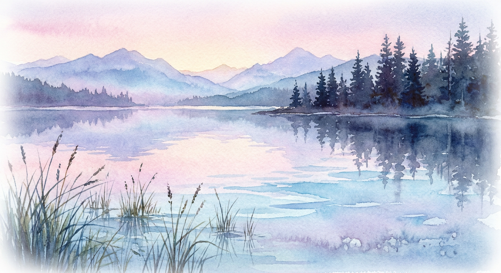

# MCP Image Generator — OpenRouter Edition 🍌🔀

> AI image generation and editing MCP server for Cursor, Claude Code, Codex, and any
> MCP-compatible tool — powered entirely by **[OpenRouter](https://openrouter.ai)**.
>
> A single-provider fork of [shinpr/mcp-image](https://github.com/shinpr/mcp-image),
> refactored to route **only** through OpenRouter so you need just one API key.

> ✅ **Status: implemented** (unit/integration tested; live end-to-end verification pending an
> API key). The verified OpenRouter API contract lives in
> [`docs/OPENROUTER_API.md`](docs/OPENROUTER_API.md), the spec in
> [`docs/SPEC.md`](docs/SPEC.md), and progress in [`docs/PROGRESS.md`](docs/PROGRESS.md).
> The original Gemini/OpenAI reference implementation is under `references/mcp-image/`.

---

## Why an OpenRouter edition?

The upstream project supports Google Gemini and OpenAI, each needing its own API subscription.
This fork removes that split: **one `OPENROUTER_API_KEY`** reaches Gemini image models (and
others) through OpenRouter's unified, OpenAI-compatible API. You keep all the image-generation
value of the original; you just pay and authenticate in one place.

## How It Works

```
You: "cat on a roof"
        ↓
  Your AI assistant infers context (purpose, style, mood, resolution...)
        ↓
  Stage 1 — Prompt optimization  (OpenRouter text model)
  Subject–Context–Style enrichment: lighting, composition, atmosphere, camera work
        ↓
  Stage 2 — Image generation  (OpenRouter Images API, e.g. google/gemini-3.1-flash-image)
  native aspect ratio / resolution when the model supports them, else folded into the prompt
        ↓
  High-quality image saved to disk, returned as an MCP resource
```

Unlike a thin API wrapper, this server **automatically enhances your prompt** and configures
sensible defaults — you don't need prompt-engineering skills. Just describe what you want.

## Features

- **Built-in prompt optimization** using the **Subject–Context–Style** framework — your short
  prompt is enriched with photographic/artistic detail via a configurable OpenRouter text model.
- **Single provider, single key** — everything goes through OpenRouter.
- **Configurable models** — pick your text and image models with environment variables.
- **Quality tiers** — `fast` / `balanced` / `quality` map to different image model IDs.
- **Image editing** (image-to-image) — transform an existing image with natural-language
  instructions while preserving its style.
- **Aspect ratios & resolution** — up to 14 aspect ratios and 1K/2K/4K sizing, passed as native
  Images-API parameters when the selected model supports them (otherwise folded into the prompt).
- **Character consistency, multi-image blending, purpose-aware, world-knowledge** feature flags.
- **Multiple output formats** — PNG, JPEG, WebP.
- **Skip enhancement** — `SKIP_PROMPT_ENHANCEMENT=true` for full manual control.

## Prerequisites

- **Node.js** 22 or higher
- An **OpenRouter API key** — get one at <https://openrouter.ai/keys>
- An MCP-compatible AI tool: **Cursor**, **Claude Code**, **Codex**, or others

## Quick Start

### 1. Get your OpenRouter API key

Create a key at <https://openrouter.ai/keys> and ensure your account has credit for the image
models you intend to use.

### 2. Build (local fork)

```bash
npm install
npm run build
```

### 3. MCP configuration

After `npm run build`, point your MCP client at `dist/index.js` with `node`. Use an **absolute**
path to both the server and (recommended) `IMAGE_OUTPUT_DIR`.

#### Claude Code

CLI (recommended):

```bash
claude mcp add mcp-image --scope user \
  --env OPENROUTER_API_KEY=your-openrouter-key \
  --env IMAGE_OUTPUT_DIR=/absolute/path/to/images \
  -- node /absolute/path/to/mcp-image-shinpr-openrouter-version/dist/index.js
```

Or add it to a project-scoped `.mcp.json` at the repo root:

```json
{
  "mcpServers": {
    "mcp-image": {
      "command": "node",
      "args": ["/absolute/path/to/mcp-image-shinpr-openrouter-version/dist/index.js"],
      "env": {
        "OPENROUTER_API_KEY": "your-openrouter-key",
        "IMAGE_OUTPUT_DIR": "/absolute/path/to/images"
      }
    }
  }
}
```

#### Claude Desktop

Edit `claude_desktop_config.json`, then fully restart Claude Desktop:

- **macOS:** `~/Library/Application Support/Claude/claude_desktop_config.json`
- **Windows:** `%APPDATA%\Claude\claude_desktop_config.json`

```json
{
  "mcpServers": {
    "mcp-image": {
      "command": "node",
      "args": ["/absolute/path/to/mcp-image-shinpr-openrouter-version/dist/index.js"],
      "env": {
        "OPENROUTER_API_KEY": "your-openrouter-key",
        "IMAGE_OUTPUT_DIR": "/absolute/path/to/images"
      }
    }
  }
}
```

> ⚠️ **Claude Desktop needs absolute paths.** It does not run inside your project directory, so a
> relative `IMAGE_OUTPUT_DIR` (like `./output`) would resolve unpredictably — always set an
> absolute path. The same applies to the path to `dist/index.js`. On Windows, escape backslashes
> in JSON (e.g. `"C:\\Users\\you\\images"`) or use forward slashes.

#### Cursor (`~/.cursor/mcp.json` or project `.cursor/mcp.json`)

```json
{
  "mcpServers": {
    "mcp-image": {
      "command": "node",
      "args": ["/absolute/path/to/mcp-image-shinpr-openrouter-version/dist/index.js"],
      "env": {
        "OPENROUTER_API_KEY": "your-openrouter-key",
        "IMAGE_OUTPUT_DIR": "/absolute/path/to/images"
      }
    }
  }
}
```

#### Codex (`~/.codex/config.toml`)

```toml
[mcp_servers.mcp-image]
command = "node"
args = ["/absolute/path/to/mcp-image-shinpr-openrouter-version/dist/index.js"]

[mcp_servers.mcp-image.env]
OPENROUTER_API_KEY = "your-openrouter-key"
IMAGE_OUTPUT_DIR = "/absolute/path/to/images"
```

#### Alternative: run via `npx` (once published to npm)

After the package is published to npm, you can skip the local build and absolute paths entirely
and let `npx` fetch and run it:

```jsonc
// Claude Desktop / Cursor
{ "command": "npx", "args": ["-y", "mcp-image-openrouter"],
  "env": { "OPENROUTER_API_KEY": "your-openrouter-key", "IMAGE_OUTPUT_DIR": "/absolute/path/to/images" } }
```
```bash
# Claude Code
claude mcp add mcp-image --scope user \
  --env OPENROUTER_API_KEY=your-openrouter-key \
  --env IMAGE_OUTPUT_DIR=/absolute/path/to/images \
  -- npx -y mcp-image-openrouter
```

> `npx` needs Node/npx on the client's PATH. Claude Desktop (a GUI app) sometimes has a limited
> PATH; if it can't find `npx`, use an absolute path to `npx`, or fall back to the local
> `node /absolute/path/dist/index.js` form above.

⚠️ **Security Note:** Never commit your API key. Use environment-specific configuration.

📁 **Path Requirements:** `IMAGE_OUTPUT_DIR` must be an absolute path; defaults to `./output`.
The directory is created automatically if missing.

## Configuration

| Variable | Required | Default | Description |
|----------|----------|---------|-------------|
| `OPENROUTER_API_KEY` | ✅ | — | Your OpenRouter API key. |
| `OPENROUTER_TEXT_MODEL` | — | `google/gemini-3.5-flash` | Model for Stage-1 prompt enhancement. |
| `OPENROUTER_IMAGE_MODEL` | — | `google/gemini-3.1-flash-image` | Image model for `fast` / `balanced`. |
| `OPENROUTER_IMAGE_MODEL_HQ` | — | falls back to `OPENROUTER_IMAGE_MODEL` | Image model for `quality` (default `google/gemini-3-pro-image` in `.env.example`). |
| `OPENROUTER_BASE_URL` | — | `https://openrouter.ai/api/v1` | Override the endpoint. |
| `OPENROUTER_IMAGE_TIMEOUT_MS` | — | `180000` | Image request timeout in ms (positive integer). GPT image models need 60-120 s. |
| `OPENROUTER_APP_URL` | — | — | Optional `HTTP-Referer` for OpenRouter attribution. |
| `OPENROUTER_APP_TITLE` | — | — | Optional `X-Title` for OpenRouter attribution. |
| `IMAGE_OUTPUT_DIR` | — | `./output` | Where images are saved (absolute path required for Claude Desktop). |
| `IMAGE_QUALITY` | — | `fast` | Default quality preset: `fast` / `balanced` / `quality`. |
| `SKIP_PROMPT_ENHANCEMENT` | — | `false` | Send prompts directly to the image model. |
| `IMAGE_INLINE_PREVIEW` | — | `true` | Attach a small inline image preview to responses (see [Viewing results](#viewing-the-result)). Set `false` for path-only. |

> Default model IDs were verified against OpenRouter on 2026-07-11 — see
> [`docs/OPENROUTER_API.md`](docs/OPENROUTER_API.md) §4. Any image/text model available on
> OpenRouter can be substituted via these env vars; a `.env` (see `.env.example`) is read
> from the package folder first, then the repo root, without overriding client-provided env config.

## Quality Presets

| Preset | Model source | Best for |
|--------|--------------|----------|
| `fast` (default) | `OPENROUTER_IMAGE_MODEL` | Quick iterations, drafts, high volume |
| `balanced` | `OPENROUTER_IMAGE_MODEL` | Production images, good quality |
| `quality` | `OPENROUTER_IMAGE_MODEL_HQ` | Final deliverables, maximum fidelity |

Override per request by asking your assistant (e.g. "generate in high quality").

## GPT image models

Set `OPENROUTER_IMAGE_MODEL` (and `OPENROUTER_IMAGE_MODEL_HQ` for the `quality` tier) to a GPT image model such as `openai/gpt-5-image`, `openai/gpt-image-2` or `openai/gpt-image-2.5-sunburst`.

| Model | Native aspect ratios | Output size | Notes |
|-------|----------------------|-------------|-------|
| `openai/gpt-5-image` (also `-mini`, `gpt-image-1`) | `1:1`, `3:2`, `2:3` | 1024x1024, 1536x1024, 1024x1536 | No `resolution` parameter |
| `openai/gpt-image-2` | adds `4:3`, `3:4`, `16:9`, `9:16`, `21:9` | e.g. `16:9` gives 1536x864 | `background`: auto or opaque |
| `openai/gpt-image-2.5-sunburst` / `-flare` | same as `gpt-image-2` | similar | More `quality` levels; transparent background allowed |

- **Timing and cost:** expect 60-120 s per image (the default `OPENROUTER_IMAGE_TIMEOUT_MS` is 180000). `openai/gpt-5-image` bills `$0.00004` per output-image token, roughly $0.04-$0.21 per image depending on quality.
- **No silent surprises:** a model only accepts the parameters it lists. An unsupported `aspectRatio` is mapped to the nearest native one (`16:9`, `21:9`, `4:3`, `5:4` become `3:2`; `9:16`, `3:4`, `4:5` become `2:3`), an unsupported `imageSize` is dropped, and the result `metadata` reports it:

```json
{ "metadata": { "durationMs": 87012, "width": 1536, "height": 1024, "format": "png",
    "requested": { "aspectRatio": "16:9", "imageSize": "4K" },
    "delivered": { "aspectRatio": "3:2", "imageSize": null },
    "warnings": ["aspectRatio 16:9 is not supported by this model (supports 1:1, 3:2, 2:3, auto); sent nearest 3:2 instead. Call get_model_guide to choose a model that supports this."] } }
```

- **Quality tier:** on `quality: "quality"` the request also carries OpenRouter `quality: "high"`, but only when the model lists a `quality` parameter. `fast` and `balanced` send none.
- **Output format:** `outputFormat` (`png`, `jpeg`, `webp`) is sent only when the model accepts it; otherwise the result carries a warning and the model decides. JPEG and WebP add compression artefacts that blur small text, so prefer PNG for diagrams.

## Diagram preset and fixing text

`preset: "diagram"` is for text-exact figures (flowcharts, slides, labelled diagrams). It sends your prompt verbatim (no Stage-1 rewrite), defaults the tier to `quality`, and requests a PNG with an opaque background where the model supports them (otherwise a white-background hint is added to the prompt). An explicit `quality` or `outputFormat` still wins.

Image models rarely get every label right first time. To fix a typo without regenerating the whole figure, feed the previous output back through `inputImagePath`:

```text
generate_image(
  preset: "diagram",
  inputImagePath: "/abs/path/output/flowchart.png",
  prompt: "Change only the label 'Encoer' to 'Encoder'. Keep everything else identical.")
```

Edit one thing per pass and state what must stay unchanged.

## Model guide

The server ships a guide to OpenRouter image models: which model for which task (text-exact diagrams, posters, slides, photoreal, vector, editing, CJK), parameters, cost, timing and prompting tips. The `generate_image` description carries a short summary; the full guide is the `get_model_guide` tool and the `guide://image-models` MCP resource.

## Example Use-Cases

Once the server is configured, you don't call the tool directly — you just **ask your AI
assistant in natural language**, and it invokes the `generate_image` tool for you. Each call
saves a PNG into your `IMAGE_OUTPUT_DIR` (`./output` by default) and returns it as an MCP
resource. The images below were generated by this server against OpenRouter and live in
[`docs/examples/`](docs/examples).

> 💡 You rarely need to write a detailed prompt. Stage-1 enhancement expands a short prompt into
> a rich, structured one before generation (e.g. the first example below grew from ~56 to ~1,356
> characters automatically).

### 1. Text → image

**You say:**
> "Generate a red panda astronaut floating in space, studio lighting."

**Assistant calls:**
```json
{ "prompt": "a red panda astronaut floating in space, studio lighting",
  "fileName": "red-panda-astronaut" }
```
→ saved to `output/red-panda-astronaut.png`:


### 2. Image editing (image-to-image)

Pass an existing image with `inputImagePath` and describe the change — the subject is preserved
while your edit is applied (this uses the Images API `input_references` field under the hood).

**You say:**
> "Take that image and change the background to a bright sunrise sky with soft clouds."

**Assistant calls:**
```json
{ "prompt": "change the background to a bright sunrise sky with soft clouds",
  "inputImagePath": "/absolute/path/output/red-panda-astronaut.png",
  "fileName": "red-panda-sunrise" }
```
→ saved to `output/red-panda-sunrise.png` — same astronaut, new backdrop:


### 3. High-quality tier

Ask for higher fidelity and the server routes to `OPENROUTER_IMAGE_MODEL_HQ`
(`google/gemini-3-pro-image` by default).

**You say:**
> "Generate a detailed watercolor of a serene mountain lake at dawn — high quality."

**Assistant calls:**
```json
{ "prompt": "a detailed watercolor painting of a serene mountain lake at dawn",
  "quality": "quality",
  "fileName": "mountain-lake-watercolor" }
```
→ saved to `output/mountain-lake-watercolor.png`:



### More one-liners to try

```
"Generate a cinematic desert at golden hour"                     (aspectRatio: "21:9")
"Professional product photo of a smartphone with sharp text"     (imageSize: "4K")
"A cozy bookshop interior, warm lighting"                        (quality: "balanced")
"Skip enhancement and use my prompt exactly as written"          (SKIP_PROMPT_ENHANCEMENT=true)
```

## Viewing the result

Every successful generation does two things:

1. **Saves the full-resolution PNG** to your `IMAGE_OUTPUT_DIR` and returns its path (as a
   `file://` resource) in the tool response — so you always have the original on disk.
2. **Attaches a small inline preview** (a downscaled JPEG, ≤512px on the longest side) so MCP
   clients that render images — like **Claude Desktop** — display the picture directly in the
   chat. The full-resolution image is never sent inline (it would exceed MCP size limits); only
   the lightweight preview is.

So in Claude Desktop you'll typically **see the image inline** *and* get the saved file path for
the full-resolution version. In clients that don't render inline images, open the saved file from
`IMAGE_OUTPUT_DIR`. To turn previews off (path-only responses), set `IMAGE_INLINE_PREVIEW=false`.

> **💡 Claude Desktop tip — the preview lives inside the tool-call block.** Claude Desktop renders
> MCP tool images **inside the `generate_image` tool-call panel**, which is often **collapsed
> behind a ▶ expander by default** — click it to reveal the image. This is a known Claude Desktop
> UI behavior ([claude-code #53256](https://github.com/anthropics/claude-code/issues/53256),
> [claude-ai-mcp #238](https://github.com/anthropics/claude-ai-mcp/issues/238)), not a
> configuration issue. Two related facts: (1) Claude Desktop has a **~1 MB limit** on tool image
> content and silently drops anything larger — which is exactly why this server sends a small
> downscaled preview rather than the full-resolution file; and (2) updating to the latest Claude
> Desktop generally improves inline rendering.

## `generate_image` Tool — Parameters

| Parameter | Type | Required | Description |
|-----------|------|----------|-------------|
| `prompt` | string | ✅ | Text description or editing instruction |
| `quality` | string | - | `fast` (default) / `balanced` / `quality` |
| `inputImagePath` | string | - | Absolute path to input image for image-to-image editing |
| `fileName` | string | - | Custom output filename (auto-generated otherwise) |
| `aspectRatio` | string | - | `1:1` (default) … `21:9`, `1:8`, `8:1` (14 options) |
| `imageSize` | string | - | `1K`, `2K`, `4K` (dropped with a warning when the model has no resolution parameter) |
| `outputFormat` | string | - | `png`, `jpeg`, `webp`; sent only when the model accepts it (JPEG/WebP add compression artefacts) |
| `preset` | string | - | `diagram`: text-exact figures (verbatim prompt, `quality` tier, PNG, opaque background) |
| `blendImages` | boolean | - | Combine multiple visual elements naturally |
| `maintainCharacterConsistency` | boolean | - | Consistent character across generations |
| `useWorldKnowledge` | boolean | - | Real-world accuracy for factual subjects |
| `useGoogleSearch` | boolean | - | Best-effort factual hint (no live grounding on OpenRouter — see note) |
| `purpose` | string | - | Intended use (e.g. "cookbook cover") — tailors style |

The server also exposes a `get_model_guide` tool (no arguments) that returns the model guide.

> **Note on `useGoogleSearch`:** the upstream Gemini provider used real Google Search grounding.
> OpenRouter's image models don't expose live web grounding (web search is a text-model feature),
> so here the flag is a best-effort "be factually accurate" hint rather than real-time retrieval —
> it never causes an error.

## Troubleshooting

- **`TIMEOUT_ERROR`:** the image request exceeded `OPENROUTER_IMAGE_TIMEOUT_MS` (default 180000 ms). GPT image models can take 60-120 s; raise the value (for example `300000`) and retry. The text client keeps its own fixed 30 s timeout.
- **`NETWORK_ERROR` / `ETIMEDOUT` on Windows:** Node's dual-stack connect timeout is too short for some networks. The server sets it to 500 ms at startup; if your client launches a different entry point, add `"NODE_OPTIONS": "--network-family-autoselection-attempt-timeout=500"` to the server `env` in your MCP config.
- **`OPENROUTER_API_KEY is required`:** the server reads `.env` from the package folder first, then the repo-root `.env` (see the [root README](../README.md)); variables set by your MCP client always win. Check that the key is in one of those files or in the client `env`.
- **Image not visible in Claude Desktop:** see the collapsed tool-call panel tip under [Viewing the result](#viewing-the-result).

## Differences from upstream shinpr/mcp-image

- **Removed** the Google Gemini (`@google/genai`) and native OpenAI (Images/Responses API)
  providers and the `IMAGE_PROVIDER` switch.
- **Prompt enhancement** (Stage 1) uses OpenRouter's OpenAI-compatible `/chat/completions`
  (via the `openai` SDK with a custom `baseURL`).
- **Image generation** (Stage 2) uses OpenRouter's dedicated **Images API**
  (`POST /api/v1/images`), returning base64 image data — called via `fetch`.
- **Native params when supported:** `aspect_ratio` and `resolution` are sent as real Images-API
  fields for models that support them (e.g. the Gemini 3.x image models). An unsupported aspect
  is mapped to the nearest native one (or folded into the prompt when the model has no aspect
  parameter) and an unsupported resolution is dropped; both are reported as `warnings`.
- **Models are configurable** via environment variables instead of hard-coded per provider.

See [`docs/SPEC.md`](docs/SPEC.md) for the spec and
[`docs/OPENROUTER_API.md`](docs/OPENROUTER_API.md) for the verified API contract.

## Development

```bash
npm run test        # vitest, all clients mocked, no API key needed
npm run check:all   # biome + lint + format + circular deps + knip + tsc + vitest
```

**Live smoke test (opt-in, one real `openai/gpt-5-image` call at OpenRouter quality `medium`, about $0.06).** Skipped unless `RUN_LIVE_SMOKE` and `OPENROUTER_API_KEY` are set (the key is read from `.env` as above); output goes to the OS temp directory and the test logs its path.

```bash
RUN_LIVE_SMOKE=1 npx vitest run src/api/__tests__/openrouterImage.live.test.ts
```

On Windows, if Node's fetch times out, prefix with `NODE_OPTIONS=--network-family-autoselection-attempt-timeout=500`. `LIVE_SMOKE_IMAGE_MODEL` and `LIVE_SMOKE_IMAGE_QUALITY` (`low` / `medium` / `high`) override the defaults; the quality override is test-only and not a tool parameter.

## Publishing to npm (maintainer)

The package is publish-ready: `prepublishOnly` runs the build so `dist/` ships in the tarball,
and the `files` allowlist includes only `dist/`, `bin/`, and `skills/` — source, tests, `.env`,
`docs/`, and generated images are excluded (verify anytime with `npm pack --dry-run`).

First publish:

```bash
# 1. (recommended) enable 2FA on your npm account, then:
npm login
# 2. confirm the name is free (a 404 means available):
npm view mcp-image-openrouter
# 3. publish (for a scoped name like @you/mcp-image-openrouter, add --access public):
npm publish
```

Later updates:

```bash
npm version patch   # or minor / major — bumps package.json + git tag
npm publish
```

Only you (and any maintainers you explicitly add) can publish new versions. Consider enabling
**"require 2FA for publish"** in the package settings on npmjs.com for extra protection.

## License

MIT License — inherits from the upstream [shinpr/mcp-image](https://github.com/shinpr/mcp-image)
project. See `LICENSE`.
